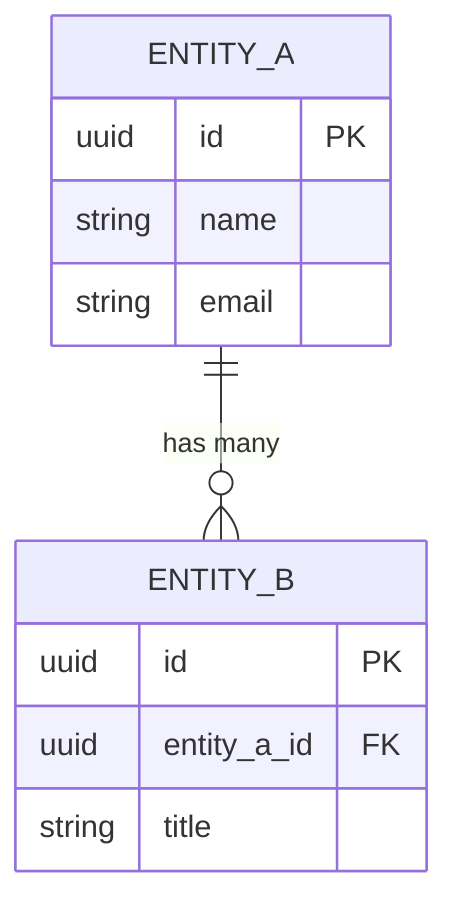
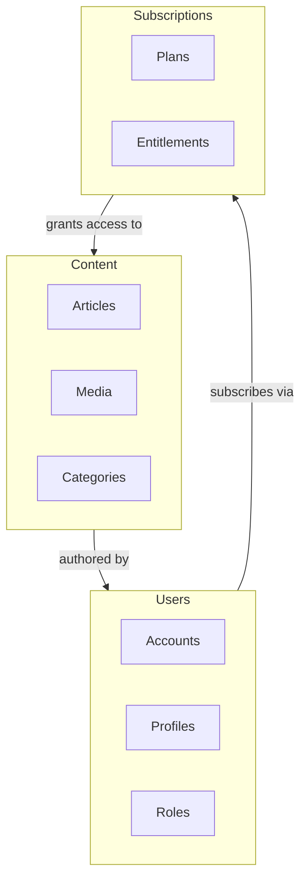

# Skill: Create Data Model

## Purpose

Produce a conceptual data model that captures the project's core entities, their relationships, and ownership boundaries. The model serves two audiences:

1. **Human designers** — Mermaid ERDs and prose descriptions for UI/UX design work
2. **AI tools** — A JSON Schema file that can be passed to design tools for automated UI generation

---

## Invocation

Use this skill when:
- The project has enough context (proposal, architecture, ADRs) to define entities and relationships
- An ADR tagged with `data-impact: yes` has been created or updated
- An integration assessment has been created or updated and its external entities need modeling
- The user asks to create, update, or review the data model
- The user says something like "create the data model", "update entities", "add HubSpot models"

---

## Phase Position

This skill runs at **Phase 5** in the elaboration workflow — after architecture (Phase 4) and before WBS (Phase 6). It requires:
- A proposal in `.project/proposals/`
- An architecture document in `.project/architecture/`
- Relevant ADRs in `.project/adr/`

---

## Owner

**Solution Architect** is the primary owner. The skill can also be invoked directly.

---

## Inputs

Before producing any output, read the following (use `read-documents` skill for source materials):

1. **Proposal** — `.project/proposals/` — for modules, features, and domain language
2. **Architecture document** — `.project/architecture/arch-*` — for components, data flows, and storage decisions
3. **ADRs** — `.project/adr/` — filter for ADRs with `data-impact: yes` in their content, plus any ADR that mentions entities, data, storage, or models
4. **Integration assessments** — `.project/architecture/integration-*` — for external system entities
5. **Existing data model** — `.project/data-model/` — if updating rather than creating from scratch
6. **Project context** — `.project/context/project-context.md`

---

## External System Models

When the data model includes entities owned by an external system (e.g. HubSpot, Salesforce, Stripe):

1. **Fetch current documentation** via Context7 MCP — call `resolve-library-id` with the system name, then `query-docs` for its data model / object schema
2. **Model external entities** with an `[External]` ownership marker
3. **Ask the user** whether custom fields on external entities should be:
   - Merged into the external entity with a `[Custom]` marker on each custom field
   - Modeled as a separate extension entity (e.g. `HubSpotContactExtension`) linked to the external entity
4. **Document the source** — note which version of the external API docs were used

External entities are modeled as-is at the current point in time. Future API changes are not the concern of this skill — the model is updated when integration assessments are revised.

---

## Intake Questions

Ask only the questions not already answered by available context. Skip questions whose answers are clear from the proposal, architecture doc, or ADRs.

1. **What are the core business domains?** — e.g. Content, Subscriptions, Users, Commerce. Used to split ERDs by domain.
2. **Which external systems contribute entities?** — e.g. HubSpot (contacts, deals), Stripe (subscriptions, invoices). Confirm against integration assessments.
3. **Are there custom fields on external entities?** — If yes: merged or separate extension entity? (Ask per external system.)
4. **Are there multi-tenancy or subscription-tier concerns that affect entity visibility?** — e.g. some entities or fields only exist for premium tiers.
5. **Any known naming conventions for entities?** — e.g. PascalCase, snake_case, domain prefixes.

---

## Output Structure

All output goes to `.project/data-model/`. Create the directory if it does not exist.

### Files produced

| File | Purpose |
|------|---------|
| `.project/data-model/README.md` | Overview: lists domains, entity counts, external systems, last updated date |
| `.project/data-model/[domain].md` | Per-domain model: entities, attributes, relationships, Mermaid ERD |
| `.project/data-model/data-model.json` | JSON Schema — machine-readable, for AI tool consumption |

### Directory layout example

```
.project/data-model/
  README.md
  content.md
  subscriptions.md
  users.md
  commerce.md
  data-model.json
```

---

## Per-Domain File Format

Each domain file follows this structure:

```markdown
# [Domain Name] — Data Model

**Last updated:** YYYY-MM-DD
**Related ADRs:** ADR-NNNN, ADR-NNNN
**External systems:** [list or "None"]

## Entities

### [EntityName]

- **Ownership:** Internal | External ([System Name]) | Synced ([System Name])
- **Description:** [One sentence — what this entity represents in the business domain]
- **Attributes:**

| Attribute | Type | Required | Description | Notes |
|-----------|------|----------|-------------|-------|
| id | UUID | Yes | Unique identifier | |
| name | String | Yes | Display name | |
| ... | ... | ... | ... | [Custom] if custom field on external entity |

- **Relationships:**

| Related Entity | Relationship | Cardinality | Description |
|---------------|-------------|-------------|-------------|
| [Entity] | has many / belongs to / ... | 1:N / N:M / 1:1 | ... |

### [Next Entity...]

## ERD

[Mermaid ERD diagram for this domain]



## Cross-Domain References

[List entities from other domains that this domain's entities reference. These appear in the ERD as stubs with a note pointing to the owning domain file.]
```

---

## ERD Splitting Rules

- **One ERD per domain file** — keep each ERD under ~20 entities for readability
- **Cross-domain references** appear as stub entities in the referencing domain's ERD, annotated with `%% See [domain].md`
- If a single domain exceeds 20 entities, split into sub-domains (e.g. `content-articles.md`, `content-media.md`)
- The README includes a **high-level domain relationship diagram** showing how domains connect (entities as groups, not individual attributes)

### README Domain Overview ERD



---

## JSON Schema Output

The `data-model.json` file contains a single JSON Schema document representing all entities across all domains. This file is designed to be passed to AI design tools for UI generation.

### Schema Structure

```json
{
  "$schema": "https://json-schema.org/draft/2020-12/schema",
  "title": "[Project Name] — Data Model",
  "description": "Conceptual data model for UI generation",
  "type": "object",
  "properties": {
    "$metadata": {
      "type": "object",
      "properties": {
        "generated": { "type": "string", "format": "date" },
        "domains": {
          "type": "array",
          "items": { "type": "string" }
        },
        "externalSystems": {
          "type": "array",
          "items": {
            "type": "object",
            "properties": {
              "name": { "type": "string" },
              "entitiesCount": { "type": "integer" },
              "docsVersion": { "type": "string" }
            }
          }
        }
      }
    }
  },
  "$defs": {
    "[EntityName]": {
      "type": "object",
      "title": "[Entity display name]",
      "description": "[One sentence description]",
      "x-domain": "[domain-name]",
      "x-ownership": "internal | external | synced",
      "x-external-system": "[system name or null]",
      "properties": {
        "id": {
          "type": "string",
          "format": "uuid",
          "x-primary-key": true
        },
        "name": {
          "type": "string",
          "description": "..."
        },
        "relatedEntityId": {
          "type": "string",
          "format": "uuid",
          "x-foreign-key": "[RelatedEntity]",
          "x-relationship": "belongs-to",
          "x-cardinality": "N:1"
        }
      },
      "required": ["id", "name"],
      "x-relationships": [
        {
          "entity": "[RelatedEntity]",
          "type": "has-many | belongs-to | many-to-many | has-one",
          "cardinality": "1:N | N:1 | N:M | 1:1",
          "description": "..."
        }
      ]
    }
  }
}
```

### JSON Schema conventions

- Use `$defs` for all entity definitions (not nested under domains — flat namespace)
- Use `x-` prefixed properties for metadata not part of standard JSON Schema: `x-domain`, `x-ownership`, `x-external-system`, `x-primary-key`, `x-foreign-key`, `x-relationship`, `x-cardinality`, `x-custom-field`
- Relationships are expressed both as FK properties on the entity AND in the `x-relationships` array (the array is the canonical source; FK properties are for tool convenience)
- Mark custom fields on external entities with `"x-custom-field": true`
- Types use JSON Schema types: `string`, `integer`, `number`, `boolean`, `array`, `object`
- Use `format` for common types: `uuid`, `date-time`, `date`, `email`, `uri`

---

## ADR Data-Impact Tagging

When creating or updating ADRs that affect the data model, add the following line to the ADR frontmatter area (below the Status line):

```
**Data Impact:** Yes
```

This skill scans for ADRs containing `Data Impact: Yes` (case-insensitive) to determine which ADRs require a data model update.

When this skill is invoked after an ADR update:
1. Read the updated ADR
2. Determine which domain(s) are affected
3. Update only the affected domain file(s) and the JSON Schema
4. Update the README's last-updated date

---

## Updating an Existing Data Model

When updating rather than creating:

1. Read all existing files in `.project/data-model/`
2. Identify what changed (new ADR, updated integration assessment, user request)
3. Update only affected domain files — do not regenerate unchanged domains
4. Regenerate `data-model.json` in full (it's a single file, partial updates are error-prone)
5. Update `README.md` with the new last-updated date and any new domains or external systems

---

## Validation Checklist

Before finalizing output, verify:

- [ ] Every entity in the proposal's module descriptions has a corresponding entity in the data model
- [ ] Every external system in integration assessments has its entities modeled with `[External]` ownership
- [ ] Every ADR with `Data Impact: Yes` is reflected in the model
- [ ] Cross-domain references are consistent (entity referenced in domain A exists in domain B)
- [ ] JSON Schema `$defs` matches the entities in the domain `.md` files exactly
- [ ] No ERD exceeds ~20 entities
- [ ] Mermaid ERDs render valid syntax
- [ ] All relationship cardinalities are specified
- [ ] README domain overview diagram is current
