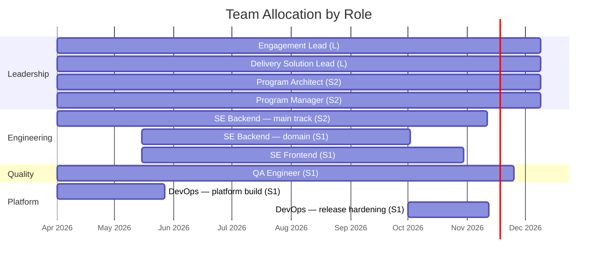

# Output Templates

Full templates for the three outputs `../SKILL.md` defines. Read the relevant section when you're actually about to write that output — these are scaffolds to fill in, not something to hold in mind throughout the design process.

## Output 1: Team Model

Save to `.project/estimates/team-model-[project-slug]-v[N.N].md`.

```markdown
# Team Model: [Project Name]

**Version:** x.x
**Date:** YYYY-MM-DD

## Team Structure

| Role | Count | Phase(s) Active | Key Responsibilities |
|------|-------|------------------|---------------------|
| ...  | ...   | ...              | ...                 |

## Ramp-Up Schedule

| Week/Month | Team Size | New Roles Joining | Notes |
|------------|-----------|-------------------|-------|
| ...        | ...       | ...               | ...   |

[DIAGRAM: Team Allocation Timeline — see "Required diagram" below]

## Skill Requirements
[Specific technical skills, domain knowledge, or certifications required. Flag any that are hard to hire for.]

## Assumptions
- [Assumption about availability, location, experience level, etc.]
```

### Required diagram: Team Allocation Timeline

Placement: in the team model, immediately after the Ramp-Up Schedule table.
Purpose: show when each role is active across the programme so ramp-up and ramp-down are visible at a glance.

Label every bar with the role name followed by its **seniority title** in parentheses — the same rule that governs `team-allocation.yaml`. Never put a headcount in the parenthetical: two people in the same role are two bars, not `(2)`.



> Replace every role, seniority title, date, and duration with confirmed values from the team model. Never leave example labels in a document shared with the client.

## Output 2: Developer Assignments Document

Produce this for a multi-EPIC programme, or any engagement with more than 2 Software Engineers. Save to `.project/estimates/developer-assignments-[project-slug].md`.

This document answers: *which stories does each SE track own, in which weeks, and why?* It is the human-readable companion to the team allocation Gantt — the Gantt shows hours, this document shows intent.

**Structure per track.** For each SE track write:
- **Track label and EPIC** — e.g., "Track B — Data Layer"
- **Active weeks** — start and end, with hours per week
- **Phase-by-phase work** — a table of phase → what the SE works on, with story IDs where estimates are finalised
- **Total raw story hours** assigned to this track
- **Exit rationale** — why this track ends when it does (domain work complete, peak window over, etc.)

**SE rotation notes.** When the same person covers multiple tracks or EPICs sequentially, document the transition: which track they finish and when, which track they join next and from which week, and why this is a clean handoff (no simultaneous double-load).

**What not to include.** Do not include project-specific infrastructure details. Describe *what type of work* each SE does, not vendor or environment names.

## Output 3: Team Allocation YAML

After completing the team model and finalising estimates, produce `.project/backlog/team-allocation.yaml`. This is the machine-readable config file consumed by `_export_wbs.py` to generate the Excel workbook. It must be in sync with the team model markdown.

**When to produce:** Phase 10, after estimates are written into all feature files and the team allocation is fully decided.

**Schema — populate every field from the team model; do not hardcode roles or hours:**

```yaml
project_name: "[Client / Project name]"
output_filename: "wbs-[project-slug]-v[N.N].xlsx"

# AI+Human factor: (1 − ai_reduction) × (1 + ceremonies) × (1 + bug_fix)
# Must match the factor confirmed during estimation (default 0.726).
ai_factor: 0.726

programme:
  total_weeks: N                    # total calendar weeks across all EPICs
  buffer_weeks: [W, W, ...]         # all buffer week numbers (programme-absolute)
  prog_buffer_weeks: [W, W, ...]    # programme-level buffers only (subset of above)
  # pa_capacity_excluded: true       # set ONLY when committed PA-persona story hours have
  #   NO delivery-capacity row covering them at all — e.g. DSL absorbs PA-persona stories
  #   but DSL is excluded from delivery capacity (leadership, not execution). If PA-persona
  #   work is instead folded into an SE's target hours (a common lean-team pattern — the SE
  #   who did the discovery work writes up their own findings), leave this unset/false: PA
  #   hours ARE backed by capacity (the SE), so the validation should count them normally.
  #   This is a stated decision, not something the export infers from role names — get it
  #   right or the Team Allocation validation row will silently compare the wrong totals.

epics:
  # No per-EPIC allocation here — the Excel export renders one programme-wide Team
  # Allocation table, never a table per EPIC (splitting by EPIC reads as one person
  # staffed multiple times on paper). `phases` and `programme_offset` still drive the
  # phase colour-coding on the single table, so they're required; `allocation` is not.
  - id: E-NN
    label: "E-NN: [EPIC Name]"
    programme_offset: N   # 0 if starts at programme W1; N if starts N weeks later
    span_start: 1
    span_end: N           # total EPIC calendar weeks
    buffer_weeks: [W, ...]
    phases:
      discovery:      {start: W, end: W}
      implementation: {start: W, end: W}
      vv:             {start: W, end: W}
      deployment:     {start: W, end: W}
      hypercare:      {start: W, end: W}   # omit this line when Hypercare is excluded from scope

programme_allocation:
  # One row per person-slot at programme-absolute week numbers (not EPIC-local).
  # For EPICs with a programme_offset: local_week + offset = programme_week.
  # One continuous row per person across their full active period — do not split by EPIC.
  # This is the ONLY allocation table in the Excel export — there is no per-EPIC table.
  #
  # CRITICAL RULES — read before writing any row:
  # 1. All delivery roles (SE, QA, DevOps) are PROGRAMME-SCOPED, not EPIC-scoped or feature-scoped.
  #    People move between EPICs/features as work completes. Never one row per EPIC.
  # 2. QA is always ONE SHARED ENGINEER across the whole programme. Never one per EPIC.
  # 3. The parenthetical is the SENIORITY TITLE (L / SL / S2 / S1 / J3 …), NOT the role abbreviation.
  #    CORRECT: "Engagement Lead (L)", "QA Engineer (S1)", "SE Backend (S2)"
  #    WRONG:   "Engagement Lead (EL)", "QA Engineer — E02 (PA)", "Software Engineer Backend — E03 (PA)"
  # 4. Standard shape: 1 EL (L) + 1 DSL (L) + 1 PA (S2) + 1 PM (S2) + 2–3 SE tracks + 1 QA + DevOps windows.
  # 5. Engagement Lead is MANDATORY on every engagement, however small — never merged into DSL or omitted.
  #    Shrink its hours toward the 4h/wk floor on a lean programme; do not drop the row.
  # 6. Minimize entries per person. The export always groups same-role entries into one rendered
  #    row (so it can never literally look like multiple hires), but keep the config itself lean:
  #    - Same rate, no true activity gap → ONE entry spanning the full range (a shared buffer
  #      week auto-zeroes inside it; don't split just because a buffer week sits in the middle).
  #    - Rate changes by phase (e.g. lighter during Discovery, full during Build) → ONE entry
  #      using `phase_hours` for the phases that differ, not a separate entry per phase.
  #    - A single step-down partway through (e.g. wind-down in the final week) → ONE entry using
  #      `reduced_from_week` + `reduced_hours`, not a second entry.
  #    - Only use genuinely separate entries for a real activity gap (the person is off the
  #      engagement for a stretch beyond the shared buffer weeks) — e.g. QA idle for two weeks
  #      because no testable Build output exists yet.
  - {role: "[Role (SeniorityTitle)]", start: W, end: W, hours: N}

summary:
  # Project-specific narrative rows for the Summary sheet. Omit a section to skip it.
  # Each entry: [label, value]. Derive from the delivery plan and team model.
  # epic_hours_breakdown: true   # opt-in only — default is the programme total only, no
  #                              # per-EPIC hour rows. Set true only when per-EPIC hours were
  #                              # explicitly requested; splitting by EPIC is not the default.
  timeline:
    - ["Programme duration", "N weeks  (W1–WN)"]
    - ["E-NN  [name]",       "W1–WN  (N weeks standalone)"]
    - ["Programme buffer weeks", "WN, WN, ...  (description)"]
  team_composition:
    - ["[Role group]", "[Count and description]"]
  delivery_model:
    - ["[Label]", "[Description]"]
```

**Validation before saving:** verify that the buffer weeks listed in `programme.buffer_weeks` are the union of all per-EPIC `buffer_weeks` (converted to programme-absolute) plus the programme-level buffer weeks. Mismatches cause incorrect colour-coding in the Excel workbook.
