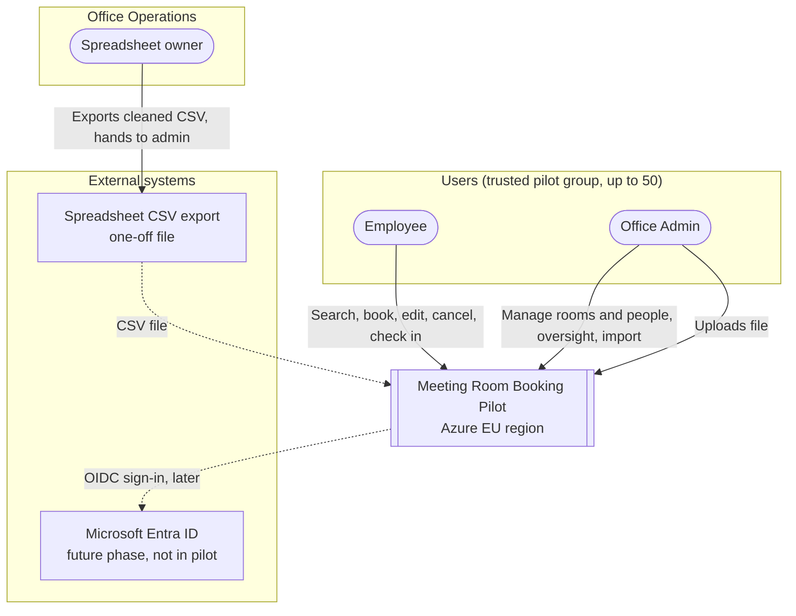
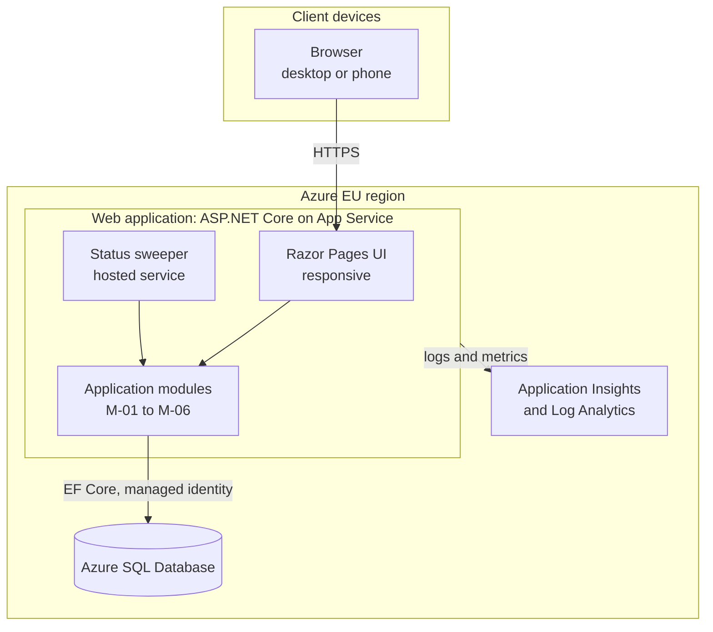
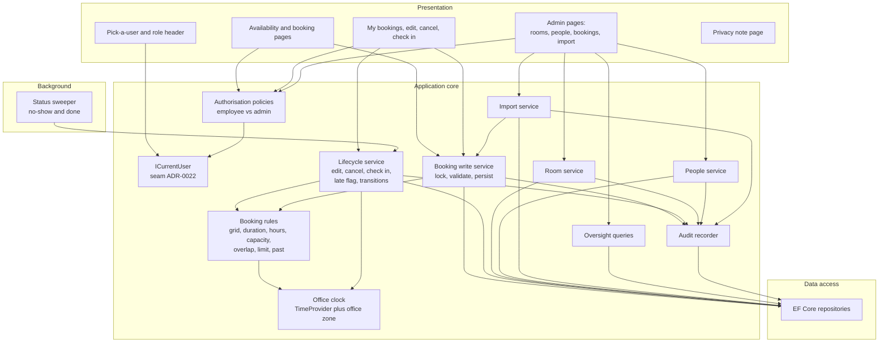
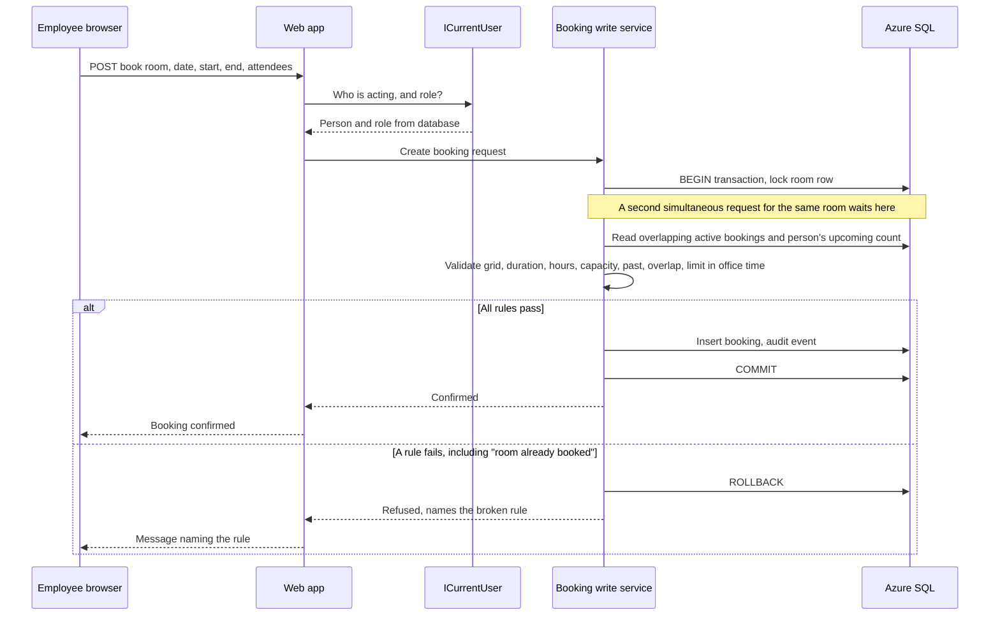
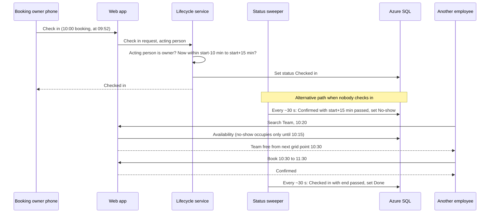
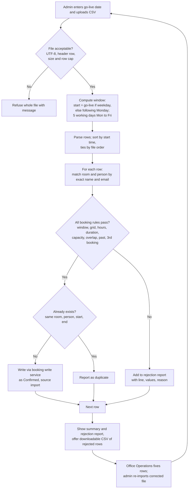
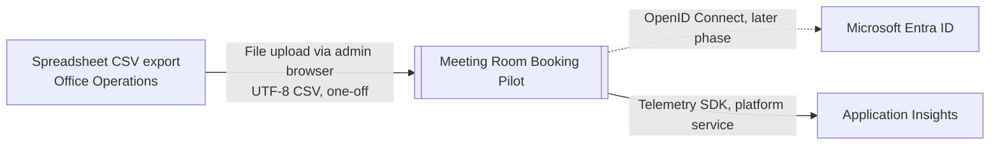
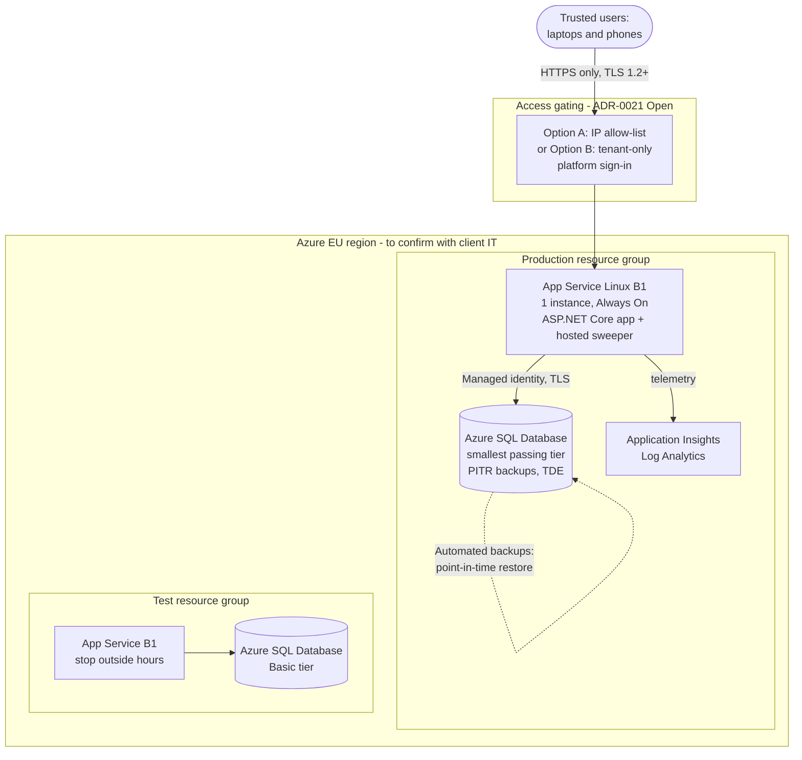

# Meeting Room Booking Pilot: Architecture Document

**Version:** 1.0
**Date:** 2026-09-29
**Status:** Superseded by arch-meeting-room-booking-v1.1.md (2026-09-29)

## Context

Office Operations books meeting rooms today through a shared spreadsheet and Slack messages, which leads to double bookings, rooms held "just in case" and no visibility of free rooms *(Source: room-booking-spec.md, Background)*. The first version is a pilot for up to 50 users with no fixed go-live date *(Sources: client-qa-2026-09-29.md, Answers 1 and 2; ADR-0001)*, hosted on Azure *(Source: ADR-0002)*, delivered as a web application usable in desktop and phone browsers *(Source: ADR-0003)*.

This document turns the six product modules (M-01 to M-06), the non-functional requirements and ADR-0001 to ADR-0015 into a technical design. The design principle throughout is to keep the pilot as small and cheap as its scale allows: one deployable application, one database, no messaging or caching infrastructure, and a clean seam where Microsoft sign-in can be added later.

Status of decisions used here: ADR-0001 to ADR-0010, ADR-0014 and ADR-0015 are Accepted. ADR-0011 to ADR-0013 (import format, clean-up ownership, 30-minute remainder minimum) are Proposed by the product definition and are treated as working assumptions. The technology choices in this document are recommendations recorded as Proposed ADRs (ADR-0016 to ADR-0020, ADR-0022); the pilot access-gating decision is an Open ADR (ADR-0021). Nothing below should be read as confirmed by the client unless it cites an Accepted ADR.

Key inputs: `.project/product-definition/` (modules, scope, NFRs, E2E scenarios, integration points), `.project/context/project-context.md`, and the source documents in `.project/input/`.

## System Context

The system is used by two kinds of people, employees and office admins, from their own laptops and phones. In the pilot there is no sign-in: a user picks their name *(Source: ADR-0005)*. The application has no live connection to any other system. Two external touchpoints exist: a one-off CSV file exported from the old spreadsheet by Office Operations and uploaded by an admin *(Source: ADR-0010, ADR-0011)*, and, in a later phase, Microsoft company-account sign-in *(Sources: client-qa-2026-09-29.md, Answer 9; ADR-0006)*. Email, calendar, Slack, HR directory and room-side devices are explicitly not integrated *(Source: integration-points.md)*.

The trust boundary that matters most is the edge of the trusted pilot group. Because pick-a-user is not authentication, that boundary must be enforced by the network or platform (ADR-0021, security assessment SEC-01), not by the application.

## Component Design

### Container view

The system is a single web application (one deployable unit) backed by one relational database. Everything else is a managed Azure platform service, not a component of the design.

### Technology recommendations (all Proposed, sized for up to 50 users)

| Concern | Recommendation | Rationale | ADR |
|---------|---------------|-----------|-----|
| Application | ASP.NET Core (current LTS), Razor Pages, server-rendered, small amount of JavaScript for the availability grid | One project, one deploy, phone-friendly, anti-forgery built in, easiest route to Entra ID later | ADR-0016 |
| Data access | Entity Framework Core with migrations | Fast to build and evolve a small schema | ADR-0016 |
| Database | Azure SQL Database, smallest tier that passes the performance test | Cheapest managed relational option; point-in-time restore satisfies NFR-008; managed identity avoids stored database passwords | ADR-0016, ADR-0017 |
| Hosting | Azure App Service (Linux, Basic B1, one instance, Always On) in one EU region | Managed, low cost, access restrictions available | ADR-0017 |
| Background work | In-process hosted service every ~30 seconds, idempotent updates, effective status computed on read | No extra resource, correct even if a run is late | ADR-0018 |
| Time | UTC storage, configured office zone (assumed Europe/Berlin), injected clock | Correct across daylight saving and testable | ADR-0019 |
| Concurrency | Per-room lock inside a transaction, single booking-write service | Guarantees NFR-005 simply | ADR-0020 |
| Identity | `ICurrentUser` seam; picker now, Entra ID later; signed cookie holds only the person id | Sign-in is additive | ADR-0022 |
| Observability | Application Insights with sampling; structured logs; audit events in the database | NFR-019, NFR-020 | ADR-0017 |
| Infrastructure as code | Bicep | Repeatable test and production environments | ADR-0017 |
| CI/CD | Pipeline on the delivery team's platform (assumed Azure DevOps Pipelines) | Assumption to confirm | ADR-0017 |

Not needed at this scale and deliberately excluded: API gateway, message queue, cache, search index, CDN, container orchestration, separate front-end application, microservices. Each can be added later without reshaping the module boundaries.

Indicative running cost (to be verified in the Azure pricing calculator for the chosen region; these are order-of-magnitude figures, not quotes): App Service Basic B1 in the low tens of dollars per month, Azure SQL Database Basic tier in single-digit dollars per month, Application Insights within or near the free monthly ingestion allowance at this volume. Two environments (test and production) therefore land in the range of a few tens of dollars per month, with the test environment able to be stopped outside working hours.

### Component view (inside the web application)

Why these components exist as separate concerns:

- **Booking rules** is a pure, stateless rule set (grid, duration 30 min to 4 h, office hours, capacity, no past, overlap, 3-booking limit) so that manual booking, edit, remainder rebooking and import all enforce identical rules *(Source: booking-import.md, IM-03)*. Every refusal returns the name of the broken rule *(Source: nfrs.md, NFR-017)*.
- **Booking write service** is the only code path that creates or moves a booking. It takes the per-room lock, re-checks the rules against current data and commits (ADR-0020). This is what makes NFR-005 hold for concurrent users and for imports.
- **Lifecycle service** owns state changes. The late flag is set only when the person cancelling is the booking owner and the cancellation is less than 2 hours before start; an admin cancelling another person's booking, and room or person deactivation, never set it *(Source: ADR-0015, decision 3)*. Check-in is permitted only when the acting person is the booking owner *(Source: ADR-0015, decision 4)*. Edits and cancellations are refused once the booking has started *(Source: ADR-0014, rule 1)*.
- **Office clock** is the only source of "now" and of local-time conversion (ADR-0019). Tests substitute a fake clock.
- **ICurrentUser** is the single place the acting person and role are established (ADR-0022). No other component reads the picker.
- **Audit recorder** records who did what and whether an admin acted, on every state change and admin action *(Source: nfrs.md, NFR-019, NFR-020)*.

### Module-to-component traceability

| Module | Components |
|--------|-----------|
| M-01 Room Booking and Availability | Availability and booking pages, booking write service, booking rules |
| M-02 Booking Lifecycle | My bookings page, lifecycle service, status sweeper |
| M-03 Room Management | Room service, admin room pages |
| M-04 People and Identity | Pick-a-user, `ICurrentUser`, authorisation policies, people service |
| M-05 Admin Booking Oversight | Oversight queries, admin bookings pages |
| M-06 Booking Import | Import service, admin import page |

## Time Handling (CET/CEST)

*(Source: ADR-0015, decision 1; ADR-0019)*

The office observes Central European Time with daylight saving; the working assumption is the IANA zone Europe/Berlin, held as configuration so it can be corrected without code change.

- **Storage.** Booking start and end are stored as UTC instants. Comparing "now" to a start or end is a plain instant comparison.
- **Rule evaluation.** Anything defined on the wall clock is evaluated after converting to office local time: the 08:00 to 20:00 office hours, Monday to Friday, the 15-minute grid, the "today" boundary, and the import window. Durations defined in elapsed time (2-hour late rule, 10 minutes before and 15 minutes after start for check-in) are computed on instants.
- **Daylight-saving transitions.** The next transitions are Sunday 25 October 2026 (clocks go back) and Sunday 28 March 2027 (clocks go forward). Both fall on a Sunday morning outside office hours, so no valid booking can sit in a skipped or repeated hour, but weekday tests, "start of day" and displayed times must still be right across the change (for example, a booking made for Monday 08:00 has a different UTC offset before and after the change). Any user input that lands on a nonexistent or ambiguous local time is refused with a clear message.
- **Display.** All screens show office local time; no time-zone selector exists *(Source: room-booking-spec.md, Not needed for now)*.
- **Testability.** The application never calls the system clock directly; it uses an injectable clock, so DST scenarios and the 10-minute, 15-minute and 2-hour boundaries are tested deterministically.

## Scheduled and Background Processing

*(Source: booking-lifecycle.md, LC-08 to LC-10; nfrs.md, NFR-006; ADR-0018)*

A hosted service in the web application wakes about every 30 seconds and applies two idempotent, set-based updates:

1. Confirmed bookings whose start plus 15 minutes has passed become No-show, with the no-show moment recorded. The remaining time then becomes bookable (the availability query already treats a no-show as occupying only the time up to the no-show moment).
2. Checked-in bookings whose end time has passed become Done.

Design points:

- **Correct even when late.** Availability, overlap and check-in logic compute an effective status from the clock: a Confirmed booking with start plus 15 minutes already passed is treated as a No-show whether or not the job has yet persisted the change. The sweeper therefore keeps stored state and reports current, but correctness of booking rules does not depend on it. This meets the 1-minute target of NFR-006 by a wide margin.
- **Safe on restart or repeat.** Updates have a status guard (`WHERE status = 'Confirmed' AND start <= threshold`), so running twice, or two instances overlapping briefly during a deployment, causes no harm.
- **No missed events.** The sweeper is state-based, not event-based; after downtime the first run catches up.
- **Always On** must be enabled so the process is not unloaded.
- A Confirmed booking that starts and is never checked in is never Done; a checked-in booking that is not ended manually becomes Done at its end time *(Source: booking-lifecycle.md, status diagram)*.

## Identity Design

*(Source: ADR-0005, ADR-0006, ADR-0014 rule 5, ADR-0022)*

**Pilot: pick a user.** A start page lists active people (name and role); choosing one stores the person's identifier in a signed, encrypted cookie. On every request the server loads the person and role from the database and derives permissions from that; a role or identifier sent by the browser is never trusted for authorisation. The header always shows who the user is acting as and their role, with a "Switch user" link. All authorisation policies (employee sees only own bookings, admin-only pages, owner-only check-in) read from `ICurrentUser`.

**Email is the key.** Person email is unique and case-insensitive *(Source: nfrs.md, NFR-023)*, matches the import `person_email` column and will match the Microsoft account later.

**Path to Microsoft Entra ID (later phase, not built now).** Replace the picker implementation of `ICurrentUser` with an OpenID Connect implementation (single-tenant to the company directory). On first sign-in the verified email claim is matched to the existing person and the Entra object identifier and tenant are stored on the person record; subsequent sign-ins match on that immutable identifier rather than on email alone, to avoid account-matching weaknesses. Roles remain in the application database (employee or admin) so no Entra group design is needed. The picker is removed or limited to a test environment. No data migration is required. See `integration-microsoft-entra-id-v1.0.md`.

**Pilot limitation.** The picker is not authentication. Anyone who can reach the site can act as any person, including an admin. This is accepted for a trusted group *(Source: ADR-0005)* and must be bounded by network or platform gating (ADR-0021, open). Owner-only check-in and employee privacy are enforced against the selected identity and can be circumvented by switching user; this is the same accepted limitation.

## Data Model (conceptual, for reasoning only)

The full conceptual model is a Phase 5 output. The entities below are the minimum needed to reason about flows and storage.

| Entity | Key attributes | Notes |
|--------|---------------|-------|
| Person | id, name, email (unique, case-insensitive), role (employee or admin), active, later: external identity reference | Owned by M-04; at most about 50 rows |
| Room | id, name (unique, case-insensitive), capacity, active | Owned by M-03; seeded with Focus, Team, Board active and Old Room inactive |
| Booking | id, room, owner person, created-by person, start (UTC), end (UTC), attendees, status, checked-in at, no-show at, late-cancellation flag, cancelled-by person, cancellation origin (owner, admin action, room deactivated, person deactivated), source (manual or import), row version | Owned by M-01 and M-02; the late flag is true only when the owner cancelled less than 2 hours before start |
| AuditEvent | id, time, acting person, action, target, details | Supports NFR-019, NFR-020 |
| ImportRun | id, admin, go-live date, window, counts, time, and rejected rows retained for the report | Supports M-06 repeatability and audit |

Ownership: one application, one database; the application owns all data. The spreadsheet is retired after import and is not a data source afterwards.

### Key flow 1: create a booking under concurrency

The second of two simultaneous requests for the same slot waits for the lock, then finds the overlap and is refused with a clear message, satisfying NFR-005 and E2E-001.

### Key flow 2: check in, no-show and remainder rebooking

## Import Flow (M-06)

*(Source: booking-import.md; ADR-0010, ADR-0011, ADR-0012, ADR-0014, ADR-0015 decision 5)*

Design points:

- **Nothing is changed silently.** A row is imported exactly as given or rejected with a reason *(Source: booking-import.md, IM-06)*.
- **Same write path as manual booking.** Each row goes through the booking write service (ADR-0020), so overlap and the 3-booking limit hold even if someone books manually during the import.
- **Ordering.** Rows are processed in start-time order (ties by file order). This satisfies "date/time order per person" for the limit and gives a deterministic winner where two rows overlap *(Source: booking-import.md, IM-04, IM-05)*.
- **Window.** The admin enters the go-live date; the window is 5 working days from that date, moving to the following Monday if it is a weekend *(Source: ADR-0015, decision 5)*. Rows outside the window are rejected. Rows dated earlier on the go-live day itself are rejected by the no-past rule; import before opening time to avoid this.
- **Repeatable.** Re-importing a corrected file reports already-imported identical rows as duplicates rather than creating them twice *(Source: booking-import.md, IM-09, assumption)*.
- **Size.** Files of a few hundred rows finish within the 1-minute target (NFR-004) because each row is a short transaction; a row and size cap protects the app.
- **Report safety.** Cell values echoed in the report and in the downloadable CSV are escaped against spreadsheet formula injection (security assessment SEC-06).
- **One-off.** The import page is admin-only and can be disabled by configuration after the pilot start *(Source: booking-import.md, IM-10, IM-11)*.

## Integration Points

Only two integrations exist, both low-risk. Azure is the platform, not an integration.

| System | Direction | Protocol and format | Authentication | Priority | Assessment |
|--------|-----------|---------------------|----------------|----------|-----------|
| Spreadsheet CSV export | Inbound, one-off | File upload over HTTPS, UTF-8 CSV with header | Uploaded by an admin acting through the app (pilot: selected identity) | P1 | `integration-spreadsheet-csv-import-v1.0.md` (Ready with caveats) |
| Microsoft Entra ID | Inbound identity, later phase | OpenID Connect, JSON web tokens | Application registration (single tenant) | P2 | `integration-microsoft-entra-id-v1.0.md` (Ready with caveats) |
| Azure platform services (App Service, Azure SQL, Application Insights) | Platform | Azure managed services, TLS | Managed identity where supported | P1 | Covered in this document; not an integration assessment |

Explicitly not integrated: email, calendar, Slack, HR directory, room-side devices, payment or facilities systems *(Source: integration-points.md)*.

## Deployment

Deployment notes:

- **Region.** An EU Azure region *(Source: ADR-0015, decision 2)*. Candidates are West Europe or Germany West Central; the choice is confirmed with client IT (ADR-0017).
- **Availability.** Single instance, best effort during office hours *(Source: nfrs.md, NFR-007)*. There is no zone redundancy or failover; a platform restart causes a brief outage, which is acceptable. Deployment slots are not needed; deploy outside office hours.
- **Backup and recovery.** Azure SQL automated backups with point-in-time restore satisfy RPO 24 hours and RTO one business day (NFR-008), with the restore procedure documented and rehearsed once before go-live. The environment is recreated from Bicep in the same time frame.
- **Transport and storage.** HTTPS only, minimum TLS 1.2, HTTP redirected; the database encrypts data at rest by default *(Source: nfrs.md, NFR-011)*.
- **Secrets.** The application reaches the database using managed identity, so there is no database password. The cookie signing key ring is persisted in the database, so restarts and redeployments do not log everyone out. No other secrets exist in the pilot.
- **Access gating.** See ADR-0021. Until it is decided and configured, the deployment must not be exposed for real data.
- **Privacy note.** A static page states what is stored (name, email, role, booking history), why, who can see it (admins see all bookings; employees see their own), how long (for the pilot duration, NFR-021), and whom to contact. Text to be agreed with Office Operations *(Source: ADR-0015, decision 2)*.
- **Environments.** Test (smallest tiers; may be stopped outside working hours) and production. Test-only clock control (needed for check-in and no-show tests) is compiled out or disabled in production.

## Non-Functional Requirements Mapping

| NFR | Requirement | Design response | Verified by |
|-----|-------------|-----------------|-------------|
| NFR-001 | Up to 50 people | Single instance and smallest SQL tier are ample; nothing user-count sensitive | Performance test at 20 concurrent users |
| NFR-002 | A few thousand bookings | Simple indexed tables (room, start, owner); no partitioning | Performance test with seeded 5,000 bookings |
| NFR-003 | Typical page under 2 s | Server-rendered pages, indexed availability query for one day | k6 p95 threshold |
| NFR-004 | Import of a few hundred rows under 1 min | Row-by-row short transactions on the shared write path; row cap | Timed integration test with 500 rows |
| NFR-005 | No double booking, ever | Per-room lock plus transactional re-check in a single write service (ADR-0020) | Parallel-request integration test |
| NFR-006 | Automatic status changes within 1 min | 30-second sweeper plus effective status on read (ADR-0018) | Fake-clock integration test; staging observation |
| NFR-007 | Available in office hours, best effort | Single App Service instance, Always On, deploy outside hours | Uptime probe (optional) |
| NFR-008 | RPO 24 h, RTO 1 business day | Azure SQL PITR; Bicep recreate | Restore rehearsal before go-live |
| NFR-009 | Not exposed beyond trusted group | Access gating (ADR-0021, open) | Manual check that the site is unreachable from outside the allow-list |
| NFR-010 | Server-side role enforcement | Authorisation policies on every page and handler; role loaded from database on each request | Role-boundary integration tests |
| NFR-011 | HTTPS only | HTTPS-only setting, TLS 1.2 minimum, HSTS | Security scan |
| NFR-012 | Privacy: own bookings only; availability without booker | Separate read models: availability never selects owner; my bookings filtered by owner | Boundary tests on availability and my-bookings |
| NFR-013 | Minimal personal data | Name, email, role, booking history only | Design review |
| NFR-014 | Data protection | EU region and privacy note (ADR-0015) | Privacy note reviewed by Office Operations |
| NFR-015 | Single office time zone with DST correctness | UTC storage, configured zone, injected clock (ADR-0019) | DST tests around 25 Oct 2026 and 28 Mar 2027 |
| NFR-016 | Desktop and phone browsers | Responsive server-rendered pages; check-in screen designed for phones | E2E on desktop and mobile viewports |
| NFR-017 | Rule failures name the rule | Rules engine returns named results | API-level tests per acceptance criterion |
| NFR-018 | Reasonable accessibility (WCAG 2.1 AA aim) | Semantic HTML, keyboard operation, contrast | Automated accessibility check in E2E |
| NFR-019 | Basic logging | Application Insights, structured logs, audit events | Log review in test |
| NFR-020 | Audit of state changes | Audit events plus actor and origin fields on booking | Integration tests on audit content |
| NFR-021 | Retain history for the pilot | No deletion; no archival | Design review |
| NFR-022 | Azure hosting | App Service, Azure SQL | Deployment |
| NFR-023 | Email as unique case-insensitive key | Unique index with case-insensitive collation | Integration test |
| NFR-024 | Low cost | Smallest suitable tiers, no extra infrastructure | Cost check after first month |

## Key Decisions

| Decision | Status | Reference |
|----------|--------|-----------|
| Pilot, up to 50 users | Accepted | ADR-0001 |
| Azure hosting | Accepted | ADR-0002 |
| Web app; check-in from own device | Accepted | ADR-0003 |
| No login in pilot; email as key | Accepted | ADR-0005, ADR-0006 |
| Office time zone CET/CEST, EU region and privacy note, admin cancellations not late-flagged, owner-only check-in, weekend go-live rule | Accepted (confirmed by project lead) | ADR-0015 |
| ASP.NET Core modular monolith with Azure SQL | Proposed | ADR-0016 |
| App Service B1, Azure SQL, EU region, Bicep | Proposed | ADR-0017 |
| In-process sweeper with effective status on read | Proposed | ADR-0018 |
| UTC storage, office-zone evaluation | Proposed | ADR-0019 |
| Per-room lock concurrency control | Proposed | ADR-0020 |
| Pilot access gating (IP allow-list or tenant-only gating) | Open | ADR-0021 |
| Current-user seam and Entra ID path | Proposed | ADR-0022 |
| CSV format, clean-up ownership, 30-minute remainder minimum | Proposed (product definition) | ADR-0011, ADR-0012, ADR-0013 |

## Key Architectural Trade-offs

- **Single instance versus resilience.** One App Service instance is cheapest and simplest; the cost is no failover. Accepted because availability is best effort in office hours (NFR-007) and recovery within one working day is sufficient (NFR-008).
- **In-process scheduler versus separate job.** Running the sweeper in the web process avoids a second resource. The cost is coupling; mitigated by idempotent updates and effective status on read (ADR-0018).
- **Lock discipline versus database constraint.** The per-room lock gives correctness with minimal machinery but relies on one write path; a slot table could be added if more write paths appear (ADR-0020).
- **Pick-a-user versus real security.** Speed and scope against a real exposure. The architecture cannot fix this inside the app; it bounds it with access gating (ADR-0021) and prepares the seam for real sign-in (ADR-0022).
- **Server-rendered versus SPA.** Fewer moving parts and no token handling now; less interactive. Adequate for the scale and an easy fit for the later sign-in.

## Open Questions

- [ ] Confirm the exact IANA time zone name (assumed Europe/Berlin) with Office Operations. Owner: project lead.
- [ ] Choose the Azure EU region and confirm subscription, policies and cost centre with client IT. Owner: project lead with client IT.
- [ ] Decide access gating (ADR-0021): does the office or VPN have a stable egress IP range, and must phones work off-network in the pilot? Owner: client IT and Office Operations. Blocks production exposure.
- [ ] Confirm the delivery team's technology preference (.NET assumed, ADR-0016). Owner: delivery lead.
- [ ] Confirm the CI/CD platform (Azure DevOps assumed). Owner: delivery lead.
- [ ] Client confirmation of ADR-0011 to ADR-0013 and of ADR-0015. Owner: project lead.
- [ ] Agree the privacy note wording and whether any company data policy requires more. Owner: Office Operations.
- [ ] Availability and backup assumptions (NFR-007, NFR-008) to be confirmed as acceptable. Owner: Office Operations.
- [ ] Is Microsoft Entra ID the exact future provider and can the client create a single-tenant app registration? Owner: client IT (needed only for the later phase).

## Risks

| # | Risk | Likelihood | Impact | Mitigation |
|---|------|------------|--------|------------|
| 1 | Pilot exposed to non-staff because pick-a-user has no authentication | Medium | High | Access gating (ADR-0021); no production exposure until configured; security assessment SEC-01 |
| 2 | Any colleague can impersonate an admin | High | Medium | Accepted by ADR-0005 for a trusted group; audit events record the selected identity; real sign-in in the next phase |
| 3 | Spreadsheet data is dirty and many rows are rejected | Medium | Medium | Rejection report; Office Operations owns clean-up (ADR-0012, Proposed); allow time for re-import |
| 4 | Time zone assumption or DST handling wrong | Low | Medium | Zone configurable; fake-clock DST tests; confirm zone name |
| 5 | Sweeper stops (process idle or crash) | Low | Low | Always On; effective status on read keeps rules correct; alert on missed heartbeat |
| 6 | Team is not .NET-skilled, forcing a stack change | Medium | Medium | Confirm before build; architecture is small enough to re-platform (ADR-0016 options) |
| 7 | Estimated Azure costs differ from expectations | Low | Low | Verify in pricing calculator; stop test environment out of hours |
| 8 | Go-live date slips, moving the import window | Medium | Low | Window is computed from the go-live date entered at import; import run just before go-live |
| 9 | Rules confirmed only by the project lead differ from client expectation | Low | Medium | Show ADR-0014 and ADR-0015 to Office Operations at next review |

## Sources

- *Sources: room-booking-spec.md; client-qa-2026-09-29.md*
- *Source: intake-meeting-room-booking-2026-09-29.md*
- *Sources: .project/product-definition/modules (M-01 to M-06), scope.md, nfrs.md, e2e-scenarios.md, integration-points.md*
- *Sources: ADR-0001 to ADR-0015 (ADR-0011 to ADR-0013 Proposed)*
