# Meeting Room Booking: Architecture Document

**Version:** 1.2
**Date:** 2026-09-29
**Status:** Draft

## Change Log

| Version | Date | Change |
|---------|------|--------|
| 1.0 | 2026-09-29 | Initial architecture. Access gating (ADR-0021) open; stack and CI/CD platform proposed or assumed |
| 1.1 | 2026-09-29 | Project lead answers applied. ADR-0021 Accepted (tenant-only Easy Auth gate), ADR-0016 Accepted (.NET), ADR-0023 Accepted (Azure DevOps Pipelines) |
| 1.2 | 2026-09-29 | Scope change from the project lead: the current phase is a local proof of concept (ADR-0024) with all functional scope (M-01 to M-06 including the full import) and infrastructure as the only exclusion. New POC scope section and local run view replace deployment as the current state. Database for the POC is SQLite (ADR-0025); concurrency section adapted. The Azure design (hosting, Easy Auth gate, CI/CD, Entra ID) is kept unchanged in substance and moved into "Target state (post-POC)". Product design (modules, components, time handling, sweeper, identity seam, import flow) is unchanged. NFR mapping gains a POC applicability column. v1.1 is superseded |
| 1.2 rev a | 2026-09-29 | Minor revision, append-only, same day, no version bump. Project lead decisions recorded in ADR-0024: the demonstration clock control is removed (time-based rules run on the real clock; the injectable clock is for automated tests only and is not exposed in the running application); the delivery team demonstrates, with no remote client access and no live trial; a configured bootstrap admin is seeded on first run if no admin exists; run instructions forbid LAN binding and public tunnels (SEC-13). Affected text is in Local Run View, POC Scope assumptions, Identity Design, Open Questions and the target-state CI/CD and environment notes |

## POC Scope

*(Source: project lead, working session 2026-09-29; ADR-0024, ADR-0025)*

On 2026-09-29 the project lead changed the plan: "We are complicating it for this MVP phase. I don't want to think about infrastructure. I want the app built locally so the client can see a POC. Deployment and infra should be later."

**The current phase is a local proof of concept.** The application runs on a developer machine (`dotnet run`, bound to localhost) and the delivery team demonstrates it to the client, in person or by screen share. Nothing is hosted.

| Aspect | In the POC (current) | Post-POC (target state) |
|--------|----------------------|--------------------------|
| Where it runs | Developer machine, localhost only | Azure App Service, EU region (ADR-0017) |
| Database | SQLite file through EF Core (ADR-0025) | Azure SQL Database (ADR-0016) |
| Access control | None needed: no network exposure. Pick-a-user inside the app (ADR-0005) | Tenant-only Easy Auth gate in front of pick-a-user (ADR-0021) |
| Identity seam | `ICurrentUser` with the pick-a-user implementation (ADR-0022, design only) | Same seam; Entra ID implementation in a later phase |
| Build and test | Developer machine; no pipeline | Azure DevOps Pipelines (ADR-0023) |
| Observability | Console and file logs; audit events in the database | Application Insights |
| Data | Synthetic seed data only | Real pilot data after go-live |
| Client access | Delivery team demonstrates | Client and employees use the hosted URL |

**Kept unchanged:** all product rules and modules M-01 to M-06; ASP.NET Core, Razor Pages, modular monolith and EF Core (ADR-0016); UTC storage with evaluation in office local time (ADR-0019); in-process status sweeper (ADR-0018); the single booking-write service for no double booking (ADR-0020, adapted to SQLite); pick-a-user identity (ADR-0005) with the `ICurrentUser` seam.

**Deferred to post-POC:** Azure hosting (ADR-0017); the Easy Auth tenant gate (ADR-0021); Azure DevOps pipelines and deployment (ADR-0023); the Entra ID sign-in path (ADR-0022, seam stays); the EU-region and privacy-note operational items (ADR-0015 decision 2); Bicep, Application Insights, managed identity, pipeline gate tokens; ZAP and k6 against deployed environments.

**Full functional scope (project lead clarification, 2026-09-29).** The POC contains all functional scope; infrastructure is the only exclusion. Every module M-01 to M-06 is fully built, including M-06 Booking Import with the ADR-0011 CSV format, rule validation, the rejected-rows report, duplicate detection and the five-working-day window rules. It is not a demonstration stub. It is tested with a synthetic or anonymised sample CSV (see Import Flow). Rooms are seeded exactly as in the specification: Focus (2), Team (6), Board (12) active and Old Room (4) inactive, with no other rooms. The three data-model decisions are accepted: "Cancelled by admin" is a label derived from `cancellation_origin`; an admin cancelling their own booking counts as `OwnerCancelled` and can be late-flagged; import report rows are purged after the import is settled.

**Decisions confirmed by the project lead (2026-09-29, ADR-0024)**

- The delivery team demonstrates the POC. There is no remote client access and no live trial with real employees.
- The application is built to production-ready quality with no demo-only features or shortcuts. There is no demonstration clock control.
- Seed and sample data are synthetic. No real client personal data enters the POC. The delivery team prepares the sample import CSV and the synthetic people and bookings before development ends.

**Security during the POC.** With the application reachable on localhost only, the network-exposure findings SEC-01 (unauthenticated picker reachable by outsiders) and SEC-12 (gate misconfiguration) are not applicable. The application must be bound to localhost only; the run instructions forbid LAN binding and public tunnels (ADR-0024, Option C rejected; SEC-13). Both findings re-activate when hosting begins.

## Context

Office Operations books meeting rooms today through a shared spreadsheet and Slack messages, which leads to double bookings, rooms held "just in case" and no visibility of free rooms *(Source: room-booking-spec.md, Background)*. The first version is a pilot for up to 50 users with no fixed go-live date *(Sources: client-qa-2026-09-29.md, Answers 1 and 2; ADR-0001)*, targeted at Azure *(Source: ADR-0002)*, delivered as a web application usable in desktop and phone browsers *(Source: ADR-0003)*. Before the pilot, a local POC is built so the client can see the product (ADR-0024).

This document turns the six product modules (M-01 to M-06), the non-functional requirements and the ADRs into a technical design. The design principle is to keep the solution as small and cheap as its scale allows: one deployable application, one database, no messaging or caching infrastructure, and a clean seam where Microsoft sign-in can be added later. The POC is the same application as the pilot, running locally on a different database provider.

Status of decisions used here: ADR-0001 to ADR-0010, ADR-0014, ADR-0015, ADR-0016, ADR-0021, ADR-0023, ADR-0024 and ADR-0025 are Accepted. ADR-0011 to ADR-0013 (import format, clean-up ownership, 30-minute remainder minimum) are Proposed by the product definition and treated as working assumptions. ADR-0017 (hosting), ADR-0018 (background processing), ADR-0019 (time handling), ADR-0020 (concurrency) and ADR-0022 (current-user seam) are Proposed recommendations. ADR-0017, ADR-0021, ADR-0022 and ADR-0023 are deferred to post-POC by ADR-0024 without a change of status. Nothing below should be read as confirmed by the client unless it cites an Accepted ADR confirmed by the client; ADR-0016, ADR-0021, ADR-0023, ADR-0024 and ADR-0025 were confirmed by the project lead.

Key inputs: `.project/product-definition/` (modules, scope, NFRs, E2E scenarios, integration points), `.project/context/project-context.md`, and the source documents in `.project/input/`.

## System Context (POC)

In the POC there are two kinds of users, employees and office admins, represented by seeded sample people. The delivery team runs the application locally and demonstrates it. Inside the application there is no login: the presenter picks a person *(Source: ADR-0005)*. The application makes no calls to any other system. Its only touchpoint is an optional CSV file, an anonymised sample of the spreadsheet export, uploaded by an admin *(Source: ADR-0010, ADR-0011)*. Email, calendar, Slack, HR directory, room-side devices and Microsoft sign-in are not integrated *(Source: integration-points.md)*. The trust boundary is the developer machine: the application listens on localhost only.

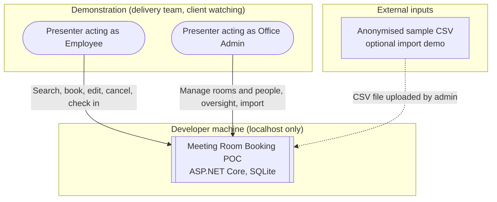

## Local Run View (POC current state)

*(Source: ADR-0024, ADR-0025)*

The POC is one process and one file. There is no server, container or cloud resource.

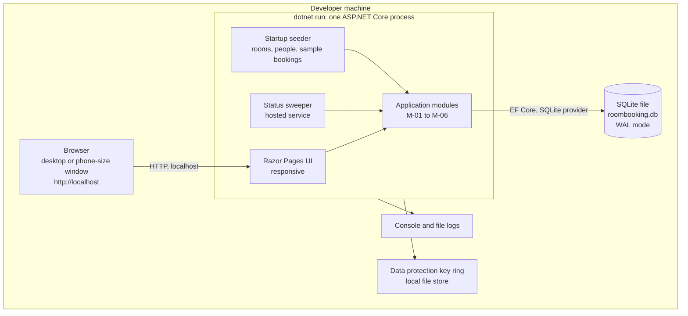

How it is used:

- **Start.** `dotnet run` from the web project. On first start the application creates the SQLite file, applies migrations and seeds data.
- **Seed data (synthetic).** Exactly the specification's rooms and no others: Focus (2), Team (6), Board (12) active and Old Room (4) inactive; several sample people with at least one admin and several employees using obviously fictional addresses; sample bookings across the coming days that make each scenario demonstrable (a free slot, a busy room, a booking about to start for check-in, a user at the 3-booking limit, a late cancellation for admin review).
- **Reset.** Delete the database file and restart to return to the clean seeded state.
- **First admin.** The startup seeder also runs a bootstrap step: if no active admin exists, it creates one from configuration (see Identity Design and ADR-0024). It is separate from the demo sample data and safe to run on every start.
- **Time.** All time-based behaviour (check-in window, no-show after 15 minutes, done marking, the 2-hour late rule) runs on the real clock. There is no demonstration clock control and no clock offset endpoint, setting or UI; the presenter uses the seeded sample bookings, which are dated relative to the start time, or waits. The clock is read only through the injectable clock abstraction (ADR-0019), which automated tests replace with a fake clock; the abstraction is not exposed in the running application.
- **Binding.** Kestrel is bound to localhost only. The run instructions forbid LAN binding (for example `0.0.0.0` or a machine IP) and public tunnels (SEC-13). Screen sharing shows the browser; phone behaviour is shown with a narrow browser window or device emulation.
- **What is not present.** Sign-in gate, HTTPS termination by a platform, Application Insights, managed identity, Bicep, pipelines.

## Component Design

### Technology recommendations

Status column: Accepted where an Accepted ADR exists, otherwise Proposed. "POC" is what is built now; "Post-POC" is the target for the hosted pilot.

| Concern | POC | Post-POC target | ADR | Status |
|---------|-----|-----------------|-----|--------|
| Application | ASP.NET Core (current LTS), Razor Pages, server-rendered, small amount of JavaScript for the availability grid | Same | ADR-0016 | Accepted |
| Data access | Entity Framework Core with migrations | Same, new Azure SQL baseline migration | ADR-0016 | Accepted |
| Database | SQLite file, WAL mode | Azure SQL Database, smallest tier that passes the performance test | ADR-0025 (POC), ADR-0016, ADR-0017 | Accepted (POC and stack); tier Proposed |
| Hosting | localhost via `dotnet run` | Azure App Service (Linux, Basic B1, one instance, Always On) in one EU region | ADR-0024, ADR-0017 | Accepted (POC); target Proposed, deferred |
| Access gating | Not needed (localhost only) | App Service authentication (Easy Auth), company tenant only | ADR-0024, ADR-0021 | Deferred; ADR-0021 stays Accepted |
| Background work | In-process hosted service every ~30 seconds, idempotent updates, effective status computed on read | Same (Always On required) | ADR-0018 | Proposed |
| Time | UTC storage, configured office zone (assumed Europe/Berlin), injected clock | Same | ADR-0019 | Proposed |
| Concurrency | Single booking-write service; overlap check and insert in one immediate SQLite write transaction | Same service with per-room UPDLOCK on Azure SQL | ADR-0020, ADR-0025 | Proposed |
| Identity | `ICurrentUser` seam with the picker; signed cookie holds only the person id | Same seam; Entra ID implementation later | ADR-0005, ADR-0022 | Accepted (picker); seam Proposed |
| Observability | Console and file logs; audit events in the database | Application Insights with sampling | ADR-0017 | Proposed, deferred |
| Infrastructure as code | None | Bicep including the gate configuration | ADR-0017 | Proposed, deferred |
| CI/CD | None; build and tests run locally | Azure DevOps Pipelines (YAML, multi-stage) | ADR-0023 | Accepted, deferred |

Not needed at this scale and deliberately excluded: API gateway, message queue, cache, search index, CDN, container orchestration, separate front-end application, microservices. Each can be added later without reshaping the module boundaries.

### Component view (inside the web application)

The component structure is unchanged from v1.1. The gate identity reader remains in the design; in the POC it always yields empty values.

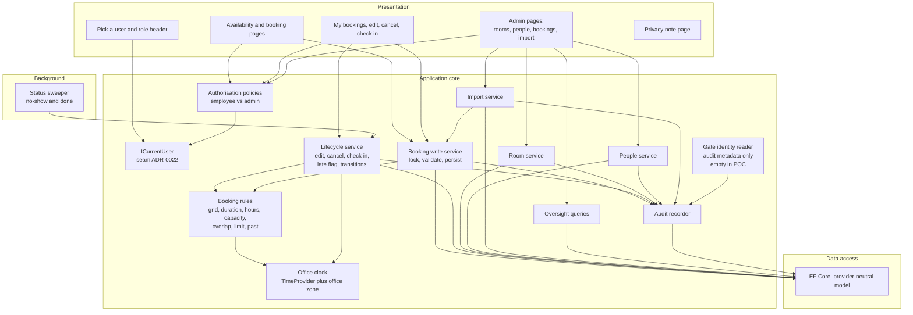

Why these components exist as separate concerns:

- **Booking rules** is a pure, stateless rule set (grid, duration 30 min to 4 h, office hours, capacity, no past, overlap, 3-booking limit) so that manual booking, edit, remainder rebooking and import all enforce identical rules *(Source: booking-import.md, IM-03)*. Every refusal returns the name of the broken rule *(Source: nfrs.md, NFR-017)*.
- **Booking write service** is the only code path that creates or moves a booking. It serialises writes, re-checks the rules against current data and commits (ADR-0020, adapted for SQLite in the Concurrency section below). This is what makes NFR-005 hold for concurrent users and for imports.
- **Lifecycle service** owns state changes. The late flag is set only when the person cancelling is the booking owner and the cancellation is less than 2 hours before start; an admin cancelling another person's booking, and room or person deactivation, never set it *(Source: ADR-0015, decision 3)*. Check-in is permitted only when the acting person is the booking owner *(Source: ADR-0015, decision 4)*. Edits and cancellations are refused once the booking has started *(Source: ADR-0014, rule 1)*.
- **Office clock** is the only source of "now" and of local-time conversion (ADR-0019). Tests substitute a fake clock.
- **ICurrentUser** is the single place the acting person and role are established (ADR-0022). No other component reads the picker.
- **Gate identity reader** reads the sign-in name and object identifier that a platform gate passes to the application and hands them to the audit recorder. It has no authorisation role (ADR-0021). In the POC there is no gate and the values are empty.
- **Audit recorder** records who did what, whether an admin acted, and the gate identity when present, on every state change and admin action *(Source: nfrs.md, NFR-019, NFR-020; ADR-0021)*.

### Module-to-component traceability

| Module | Components |
|--------|-----------|
| M-01 Room Booking and Availability | Availability and booking pages, booking write service, booking rules |
| M-02 Booking Lifecycle | My bookings page, lifecycle service, status sweeper |
| M-03 Room Management | Room service, admin room pages |
| M-04 People and Identity | Pick-a-user, `ICurrentUser`, authorisation policies, people service, gate identity reader |
| M-05 Admin Booking Oversight | Oversight queries, admin bookings pages |
| M-06 Booking Import | Import service, admin import page |

## Time Handling (CET/CEST)

*(Source: ADR-0015, decision 1; ADR-0019). Unchanged from v1.1.*

The office observes Central European Time with daylight saving; the working assumption is the IANA zone Europe/Berlin, held as configuration so it can be corrected without code change.

- **Storage.** Booking start and end are stored as UTC instants (UTC `DateTime` values, ADR-0025). Comparing "now" to a start or end is a plain instant comparison.
- **Rule evaluation.** Anything defined on the wall clock is evaluated after converting to office local time: the 08:00 to 20:00 office hours, Monday to Friday, the 15-minute grid, the "today" boundary, and the import window. Durations defined in elapsed time (2-hour late rule, 10 minutes before and 15 minutes after start for check-in) are computed on instants.
- **Daylight-saving transitions.** The next transitions are Sunday 25 October 2026 (clocks go back) and Sunday 28 March 2027 (clocks go forward). Both fall on a Sunday morning outside office hours, so no valid booking can sit in a skipped or repeated hour, but weekday tests, "start of day" and displayed times must still be right across the change. Any user input that lands on a nonexistent or ambiguous local time is refused with a clear message.
- **Display.** All screens show office local time; no time-zone selector exists *(Source: room-booking-spec.md, Not needed for now)*.
- **Testability.** The application never calls the system clock directly; it uses an injectable clock, so DST scenarios and the 10-minute, 15-minute and 2-hour boundaries are tested deterministically. The same clock makes the demonstration time control possible.

## Scheduled and Background Processing

*(Source: booking-lifecycle.md, LC-08 to LC-10; nfrs.md, NFR-006; ADR-0018). Unchanged from v1.1 except that the process only runs while the POC is running.*

A hosted service in the web application wakes about every 30 seconds and applies two idempotent, set-based updates:

1. Confirmed bookings whose start plus 15 minutes has passed become No-show, with the no-show moment recorded. The remaining time then becomes bookable.
2. Checked-in bookings whose end time has passed become Done.

Design points:

- **Correct even when late.** Availability, overlap and check-in logic compute an effective status from the clock: a Confirmed booking with start plus 15 minutes already passed is treated as a No-show whether or not the job has persisted the change. Correctness of booking rules does not depend on the sweeper.
- **Safe on restart or repeat.** Updates carry a status guard (`WHERE status = 'Confirmed' AND start <= threshold`), so running twice causes no harm.
- **No missed events.** The sweeper is state-based; after the POC has been stopped, the first run after start-up catches up.
- **Locally**, the process only sweeps while it is running. Because of the effective-status rule, a booking whose time passed while the POC was off is still treated correctly the moment the app starts.
- **Post-POC**, Always On must be enabled on App Service so the process is not unloaded.
- A Confirmed booking that starts and is never checked in is never Done; a checked-in booking that is not ended manually becomes Done at its end time *(Source: booking-lifecycle.md, status diagram)*.

## Concurrency and the No-double-booking Guarantee

*(Source: nfrs.md, NFR-005; ADR-0020; ADR-0025)*

All writes that create or move a booking go through one booking-write service used by manual booking, edit, remainder rebooking and import.

- **POC (SQLite).** SQLite permits one writer at a time. The service opens an immediate write transaction (the write lock is taken at the start, before the overlap check), re-checks every rule against current data, inserts or updates, and commits. A concurrent request waits for the lock (the database runs in WAL mode with a busy timeout) and then finds the overlap and is refused with the named rule. A deferred transaction is not acceptable because two requests could both read before either writes. The exact API and settings are verified against current Microsoft.Data.Sqlite documentation at build time.
- **Post-POC (Azure SQL).** The per-room UPDLOCK on the room row inside a transaction, as proposed in ADR-0020, serialises writes per room. Both rooms are locked in a fixed order when an edit changes room.
- **Proof.** A parallel-request integration test shows exactly one of N simultaneous identical requests succeeds. It runs against SQLite now and is re-run against Azure SQL (Testcontainers) before hosting.

## Identity Design

*(Source: ADR-0005, ADR-0006, ADR-0014 rule 5, ADR-0022; ADR-0021 for the post-POC gate)*

**POC: pick a user.** A start page lists active people (name and role); choosing one stores the person's identifier in a signed, encrypted cookie. On every request the server loads the person and role from the database and derives permissions from that; a role or identifier sent by the browser is never trusted for authorisation. The header always shows who the presenter is acting as and their role, with a "Switch user" link, which suits demonstrations of employee and admin views. All authorisation policies (employee sees only own bookings, admin-only pages, owner-only check-in) read from `ICurrentUser`.

**Email is the key.** Person email is unique and case-insensitive *(Source: nfrs.md, NFR-023)*, matches the import `person_email` column and will match the Microsoft account later. In the POC uniqueness uses the SQLite `NOCASE` collation (ASCII folding).

**Gate identity (post-POC).** The Easy Auth gate (ADR-0021) supplies an authenticated sign-in name and object identifier. The audit recorder stores them with every audit event beside the picked person; they never authorise anything. The model fields exist now and are empty in the POC.

**Path to Microsoft Entra ID sign-in inside the application (later phase, not built).** Replace the picker implementation of `ICurrentUser` with an OpenID Connect implementation (single tenant). On first sign-in the verified email claim is matched to the existing person and the Entra object identifier and tenant are stored; subsequent sign-ins match on that identifier. Roles remain in the application database. No data migration is required. See `integration-microsoft-entra-id-v1.0.md`. No Entra work is done in the POC.

**First-admin bootstrap (ADR-0024, 2026-09-29).** Because there is no login and admins are created by admins (people management), an admin must exist at startup. Neither this document, the data model nor the module definitions defined a bootstrap before this revision (PI-07 only protects the last active admin). Approach: on startup, if no active person with the admin role exists, the application creates one from configuration (name and email under a `BootstrapAdmin` settings section). If an active admin exists, the step does nothing, so it is idempotent and never overwrites or re-promotes anyone. Production-safe behaviour: no hard-coded default account; if no admin exists and the settings are missing or invalid, startup fails with a clear message; the created person is audited as a system action; the email is treated as an ordinary person key (unique, case-insensitive) and the admin can be deactivated or demoted through people management once another active admin exists (PI-07). Demo sample people are separate from this step.

**Limitation.** The picker is not authentication. Anyone who can reach the application can act as any person, including an admin. In the POC this is bounded by the application listening on localhost only; post-POC it is bounded by the gate (ADR-0021) and the audit trail.

## Data Model (conceptual, for reasoning only)

The full conceptual model is in `.project/data-model/` (Phase 5). The entities below are the minimum needed to reason about flows and storage.

| Entity | Key attributes | Notes |
|--------|---------------|-------|
| Person | id, name, email (unique, case-insensitive), role (employee or admin), active, later: external identity reference | Owned by M-04; at most about 50 rows |
| Room | id, name (unique, case-insensitive), capacity, active | Owned by M-03; seeded with Focus, Team, Board active and Old Room inactive |
| Booking | id, room, owner person, created-by person, start (UTC), end (UTC), attendees, status, checked-in at, no-show at, late-cancellation flag, cancelled-by person, cancellation origin, source (manual or import), concurrency token | Owned by M-01 and M-02 |
| AuditEvent | id, time, acting person, gate sign-in name and object identifier (nullable, empty in POC), action, target, details | Supports NFR-019, NFR-020 |
| ImportRun | id, admin, go-live date, window, counts, time, and rejected rows retained for the report | Supports M-06 repeatability and audit |

Ownership: one application, one database; the application owns all data. The spreadsheet is retired after import and is not a data source afterwards.

**POC storage mapping (SQLite).** The model is provider-neutral. Where SQLite differs from Azure SQL: instants are UTC `DateTime` stored as ISO-8601 text (no `DateTimeOffset`); GUIDs are stored as text; case-insensitive uniqueness of email and room name uses `NOCASE`; `row_version` is an application-managed concurrency token because SQLite has no `rowversion`; the JSON-text fields (`AuditEvent.details`, `ImportReportRow.reasons`) are plain text. See `.project/data-model/README.md` and ADR-0025.

### Key flow 1: create a booking under concurrency

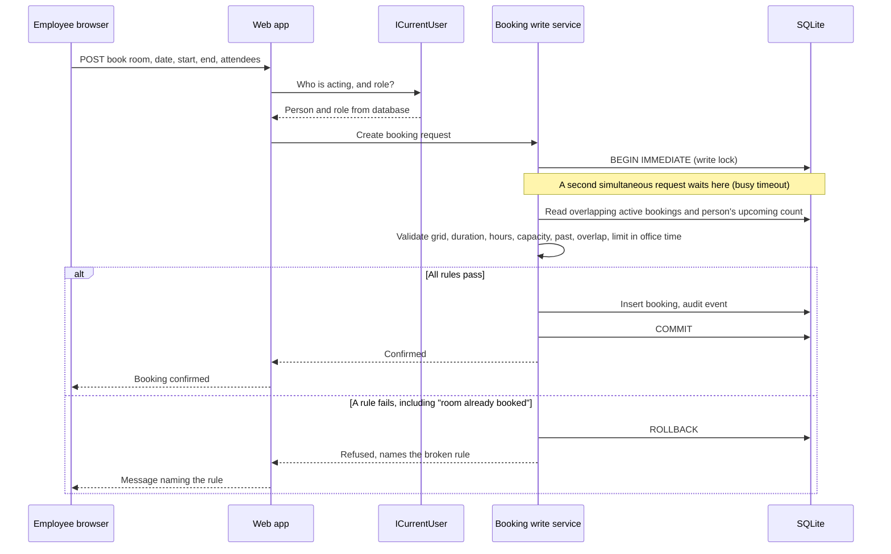

On Azure SQL the first step becomes "BEGIN transaction, lock room row" (ADR-0020). The second of two simultaneous requests for the same slot is refused with a clear message, satisfying NFR-005 and E2E-001.

### Key flow 2: check in, no-show and remainder rebooking

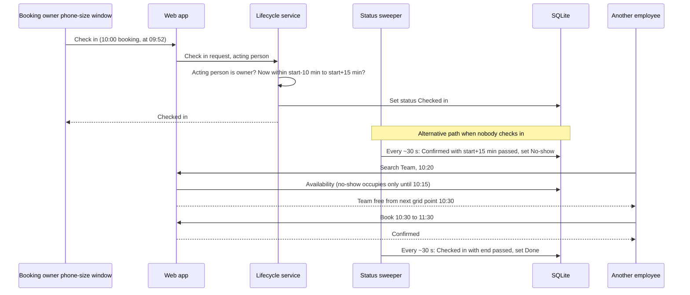

## Import Flow (M-06)

*(Source: booking-import.md; ADR-0010, ADR-0011, ADR-0012, ADR-0014, ADR-0015 decision 5). Unchanged from v1.1.*

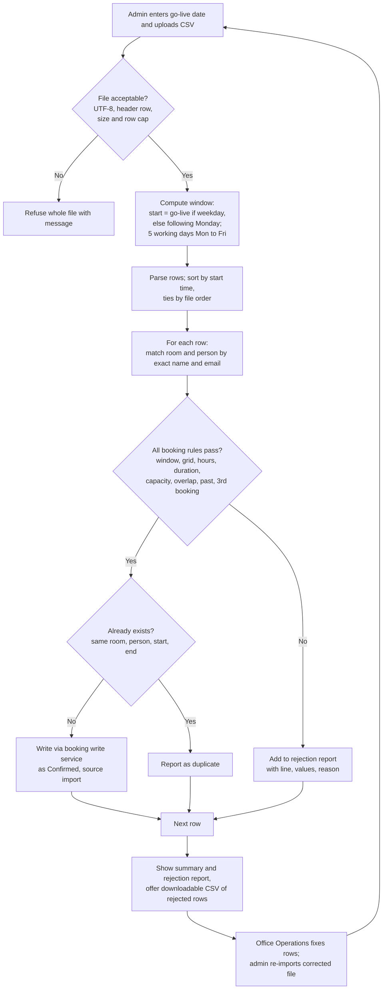

Design points:

- **Nothing is changed silently.** A row is imported exactly as given or rejected with a reason *(Source: booking-import.md, IM-06)*.
- **Same write path as manual booking.** Each row goes through the booking write service, so overlap and the 3-booking limit hold even if someone books manually during the import.
- **Ordering.** Rows are processed in start-time order (ties by file order) *(Source: booking-import.md, IM-04, IM-05)*.
- **Window.** The admin enters the go-live date; the window is 5 working days from that date, moving to the following Monday if it is a weekend *(Source: ADR-0015, decision 5)*. Rows dated earlier on the go-live day itself are rejected by the no-past rule.
- **Repeatable.** Re-importing a corrected file reports already-imported identical rows as duplicates *(Source: booking-import.md, IM-09, assumption)*.
- **Size.** Files of a few hundred rows finish within the 1-minute target (NFR-004); a row and size cap protects the app.
- **Report safety.** Cell values echoed in the report and in the downloadable CSV are escaped against spreadsheet formula injection (SEC-06).
- **One-off.** The import page is admin-only and can be disabled by configuration *(Source: booking-import.md, IM-10, IM-11)*.
- **Report retention.** Rejected-row report data (`ImportReportRow`) is purged after the import is settled (accepted by the project lead, 2026-09-29), because it can hold emails that match no person. The ImportRun summary and audit event remain.
- **POC data and sample file.** The full import is in the POC and is exercised with a synthetic sample CSV (columns `room`, `person_email`, `date`, `start`, `end`, `attendees`) that uses the seeded room names and the seeded fictional people's emails. The sample file is generated relative to the go-live date entered and contains: valid rows across the five-working-day window; one row for each rejection reason (unknown room, inactive Old Room, unknown person, outside window, weekend date, off grid, outside office hours, too short, too long, capacity exceeded, overlap with another row, beyond the third booking for a person, in the past); one exact duplicate row; and a formula-leading cell (for SEC-06). A second file with a wrong header tests whole-file refusal. No real spreadsheet export enters the POC; if Office Operations later supplies one, it is anonymised first.

## Integration Points (POC)

One touchpoint exists in the POC, and it is a file. Nothing else is integrated. Microsoft Entra ID, the Easy Auth gate and Azure platform services are post-POC (see Target state).

| System | Direction | Protocol and format | Authentication | Priority | Assessment |
|--------|-----------|---------------------|----------------|----------|-----------|
| Spreadsheet CSV export (anonymised sample in the POC) | Inbound, one-off | File upload over HTTP on localhost, UTF-8 CSV with header | Uploaded by an admin acting through the app (selected identity) | P1 | `integration-spreadsheet-csv-import-v1.0.md` (Ready with caveats); full import behaviour is in the POC |
| Microsoft Entra ID (gate and in-app sign-in) | Deferred | OpenID Connect | Deferred | Post-POC | `integration-microsoft-entra-id-v1.0.md` (unchanged; applies to the post-POC phase) |
| Azure platform services | Deferred | Azure managed services | Deferred | Post-POC | Covered in Target state below |

Explicitly not integrated: email, calendar, Slack, HR directory, room-side devices, payment or facilities systems *(Source: integration-points.md)*.

## Non-Functional Requirements Mapping

"POC applicability" states whether the requirement is checked during the local POC. Deferred rows are not dropped; they apply again to the hosted pilot.

| NFR | Requirement | Design response | POC applicability | Verified by |
|-----|-------------|-----------------|-------------------|-------------|
| NFR-001 | Up to 50 people | Nothing user-count sensitive | Applies (seed of up to 50 people is enough) | Performance smoke locally |
| NFR-002 | A few thousand bookings | Simple indexed tables (room, start, owner) | Applies | Local test with seeded 5,000 bookings |
| NFR-003 | Typical page under 2 s | Server-rendered pages, indexed availability query | Applies locally (indicative only; Azure figures come later) | Local timing check |
| NFR-004 | Import of a few hundred rows under 1 min | Row-by-row short transactions on the shared write path; row cap | Applies | Timed integration test with 500 rows |
| NFR-005 | No double booking, ever | Single write service with immediate SQLite write transaction (POC); per-room lock (Azure SQL) | Applies | Parallel-request integration test |
| NFR-006 | Automatic status changes within 1 min | 30-second sweeper plus effective status on read | Applies | Fake-clock integration test |
| NFR-007 | Available in office hours, best effort | Single App Service instance, Always On | Deferred to post-POC | Uptime probe (later) |
| NFR-008 | RPO 24 h, RTO 1 business day | Azure SQL PITR; Bicep recreate | Deferred to post-POC (POC data is disposable; reset by re-seeding) | Restore rehearsal before go-live |
| NFR-009 | Not exposed beyond trusted group | Localhost only in the POC; Easy Auth gate post-POC (ADR-0021) | Met by not exposing; gate deferred | Manual check that the app listens on localhost only; gate checks post-POC |
| NFR-010 | Server-side role enforcement | Authorisation policies on every page and handler; role loaded from database on each request | Applies | Role-boundary integration tests |
| NFR-011 | HTTPS only | Platform HTTPS and TLS 1.2 minimum, HSTS | Deferred (HTTP on localhost is acceptable) | Security scan post-POC |
| NFR-012 | Privacy: own bookings only; availability without booker | Separate read models | Applies | Boundary tests |
| NFR-013 | Minimal personal data | Name, email, role, booking history; gate sign-in name post-POC | Applies (synthetic data only) | Design review |
| NFR-014 | Data protection | EU region and privacy note (ADR-0015 decision 2) | Deferred; synthetic data only in the POC | Privacy note reviewed post-POC |
| NFR-015 | Single office time zone with DST correctness | UTC storage, configured zone, injected clock | Applies | DST tests around 25 Oct 2026 and 28 Mar 2027 |
| NFR-016 | Desktop and phone browsers | Responsive server-rendered pages | Applies (demonstrated with a phone-size window or emulation) | E2E on desktop and mobile viewports |
| NFR-017 | Rule failures name the rule | Rules engine returns named results | Applies | API-level tests per acceptance criterion |
| NFR-018 | Reasonable accessibility (WCAG 2.1 AA aim) | Semantic HTML, keyboard operation, contrast | Applies | Automated accessibility check in E2E |
| NFR-019 | Basic logging | Console and file logs plus audit events (POC); Application Insights post-POC | Applies (local logs) | Log review in test |
| NFR-020 | Audit of state changes | Audit events plus actor and origin fields | Applies | Integration tests on audit content |
| NFR-021 | Retain history for the pilot | No deletion; no archival | Applies | Design review |
| NFR-022 | Azure hosting | App Service, Azure SQL | Deferred to post-POC | Deployment |
| NFR-023 | Email as unique case-insensitive key | Unique index with case-insensitive collation (`NOCASE` in the POC) | Applies | Integration test |
| NFR-024 | Low cost | Smallest suitable tiers | POC has no running cost; Azure cost check post-POC | Cost check after first hosted month |

## Key Decisions

| Decision | Status | Reference |
|----------|--------|-----------|
| Pilot, up to 50 users | Accepted | ADR-0001 |
| Azure hosting (target) | Accepted; deferred to post-POC | ADR-0002, ADR-0024 |
| Web app; check-in from own device | Accepted | ADR-0003 |
| No login in pilot; email as key | Accepted | ADR-0005, ADR-0006 |
| Office time zone CET/CEST, EU region and privacy note, admin cancellations not late-flagged, owner-only check-in, weekend go-live rule | Accepted; EU region and privacy note operationally deferred | ADR-0015 |
| ASP.NET Core modular monolith with Azure SQL as target database | Accepted | ADR-0016 |
| Local POC first; infrastructure and deployment deferred | Accepted (project lead 2026-09-29) | ADR-0024 |
| SQLite as the POC database, provider-neutral model | Accepted (project lead 2026-09-29) | ADR-0025 |
| App Service B1, Azure SQL tier, EU region, Bicep | Proposed; deferred to post-POC | ADR-0017 |
| In-process sweeper with effective status on read | Proposed | ADR-0018 |
| UTC storage, office-zone evaluation | Proposed | ADR-0019 |
| Single booking-write service; SQLite write transaction now, per-room lock on Azure SQL | Proposed | ADR-0020, ADR-0025 |
| Pilot access gating: tenant-only Easy Auth | Accepted; deferred to post-POC | ADR-0021, ADR-0024 |
| Current-user seam and Entra ID path | Proposed; seam kept, Entra work deferred | ADR-0022 |
| Azure DevOps Pipelines as CI/CD platform | Accepted; deferred to post-POC | ADR-0023, ADR-0024 |
| CSV format, clean-up ownership, 30-minute remainder minimum | Proposed (product definition) | ADR-0011, ADR-0012, ADR-0013 |

## Key Architectural Trade-offs

- **Local POC versus hosted demonstration.** Going local removes all infrastructure and client IT dependencies from the first demonstration. The cost is that the client cannot use it remotely and that hosted-environment risks (gate, Azure SQL behaviour, deployment permissions) stay unretired. Accepted by the project lead (ADR-0024).
- **SQLite now, Azure SQL later.** Zero installation and instant reset against a different engine. SQLite results do not prove SQL Server locking, collation or `rowversion` behaviour, so the concurrency and collation tests are repeated on Azure SQL before hosting. The provider-neutral model and one persistence configuration point keep the switch small (ADR-0025).
- **Single instance versus resilience (post-POC).** One App Service instance is cheapest and simplest; the cost is no failover. Accepted because availability is best effort in office hours (NFR-007) and recovery within one working day is sufficient (NFR-008).
- **In-process scheduler versus separate job.** Running the sweeper in the web process avoids a second resource. The cost is coupling; mitigated by idempotent updates and effective status on read (ADR-0018).
- **Serialised writes versus a database constraint.** Correctness relies on the one write path; SQLite's single writer (POC) and the per-room lock (Azure SQL) both depend on it. A slot table could be added if more write paths appear (ADR-0020).
- **Pick-a-user without a gate versus real security.** In the POC the exposure is nil because the app is local. When hosted, the gate (ADR-0021) confines the risk to authenticated tenant members and the audit trail makes it attributable; real sign-in removes it (ADR-0022).
- **Server-rendered versus SPA.** Fewer moving parts and no token handling; less interactive. Adequate for the scale.

---

# Target State (post-POC)

*The sections below are the Azure design from v1.1, retained unchanged in substance. It is not being built in the POC phase. It applies when the post-POC phase starts (ADR-0024). ADR-0017 remains Proposed; ADR-0021 and ADR-0023 remain Accepted.*

## Target System Context

Users reach the pilot from their own laptops and phones on or off the office network. Every request first passes a Microsoft sign-in gate restricted to the company tenant (platform-level App Service authentication, ADR-0021). Inside the application there is no login: a user picks their name (ADR-0005). The boundary that matters most is the edge of the trusted pilot group; because pick-a-user is not authentication, that boundary is enforced by the platform gate. Residual risk: anyone who passes the gate can still pick any user, including an admin (accepted in ADR-0005, made attributable by the audit trail).

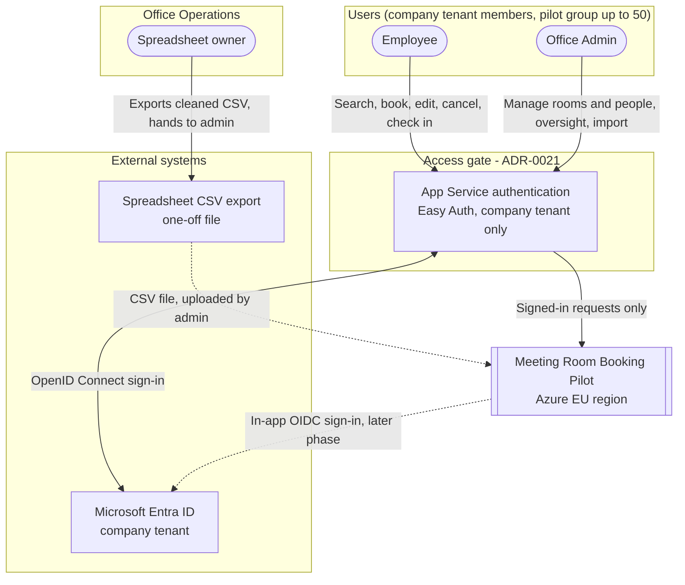

## Target Container View

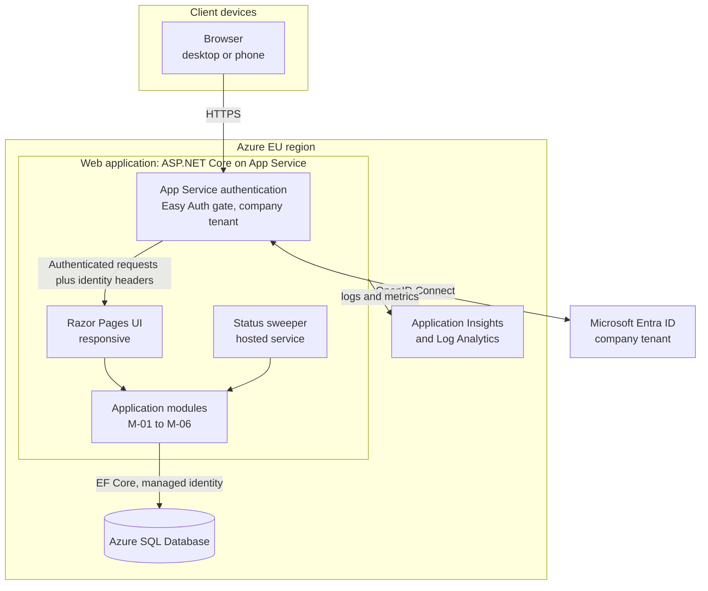

Indicative running cost (to be verified in the Azure pricing calculator; order-of-magnitude, not quotes): App Service Basic B1 in the low tens of dollars per month, Azure SQL Database Basic tier in single-digit dollars per month, Application Insights within or near the free ingestion allowance. Two environments (test and production) land in the range of a few tens of dollars per month, with the test environment able to be stopped outside working hours.

## Target Integration Landscape

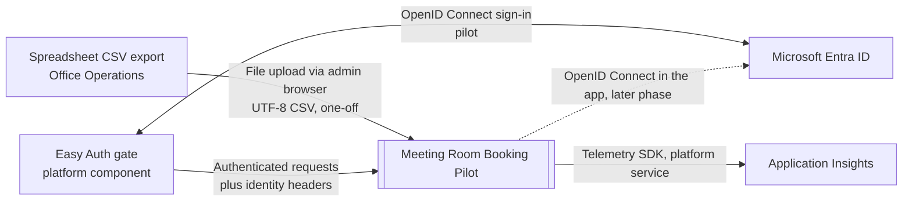

| System | Direction | Protocol and format | Authentication | Priority | Assessment |
|--------|-----------|---------------------|----------------|----------|-----------|
| Spreadsheet CSV export | Inbound, one-off | File upload over HTTPS, UTF-8 CSV with header | Uploaded by an admin acting through the app (selected identity behind the gate) | P1 | `integration-spreadsheet-csv-import-v1.0.md` |
| Microsoft Entra ID, platform gate | Sign-in, performed by the Azure platform in front of the app | OpenID Connect, single-tenant app registration | App registration in the company tenant; client IT permission required | P1 (hosted pilot) | `integration-microsoft-entra-id-v1.0.md` (addendum 2026-09-29; Ready with caveats) |
| Microsoft Entra ID, in-app sign-in (later) | Inbound identity, later phase | OpenID Connect, JSON web tokens | Application registration (single tenant) | P2 | `integration-microsoft-entra-id-v1.0.md` |
| Azure platform services (App Service, Azure SQL, Application Insights) | Platform | Azure managed services, TLS | Managed identity where supported | P1 (hosted pilot) | Covered in this document; not an integration assessment |

## Target Flow: First Visit Through the Access Gate

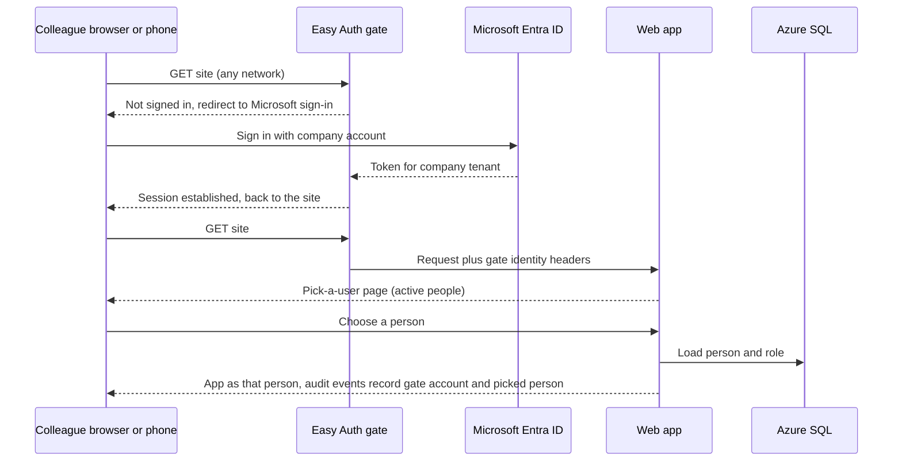

An account outside the tenant, or not assigned when user assignment is required, is refused at Microsoft sign-in and never reaches the application.

## Target CI/CD (Azure DevOps)

*(Source: ADR-0023; deferred by ADR-0024)*

Azure DevOps Pipelines is the CI/CD platform. Pipelines are YAML in the repository.

| Stage | Trigger | What happens |
|-------|---------|--------------|
| Pull-request validation | Every pull request | Restore, build, unit tests (developer-owned), integration and API/contract tests with SQL Server containers, dependency vulnerability scan |
| Merge to main | Merge | Same checks, publish artifact, deploy Bicep and the application to the test environment, run the E2E smoke set through the gate |
| Nightly | Schedule | Full E2E, performance and security baseline against the test environment |
| Production | Manual approval on an Azure DevOps environment | Deploy the tested artifact outside office hours; verify that no clock control exists in the build and that unauthenticated requests are redirected to sign-in |

Deployment to Azure uses a service connection to the client's subscription, preferably with workload identity federation. Where the Azure DevOps organisation and the source repository are hosted is not stated.

## Target Deployment Topology

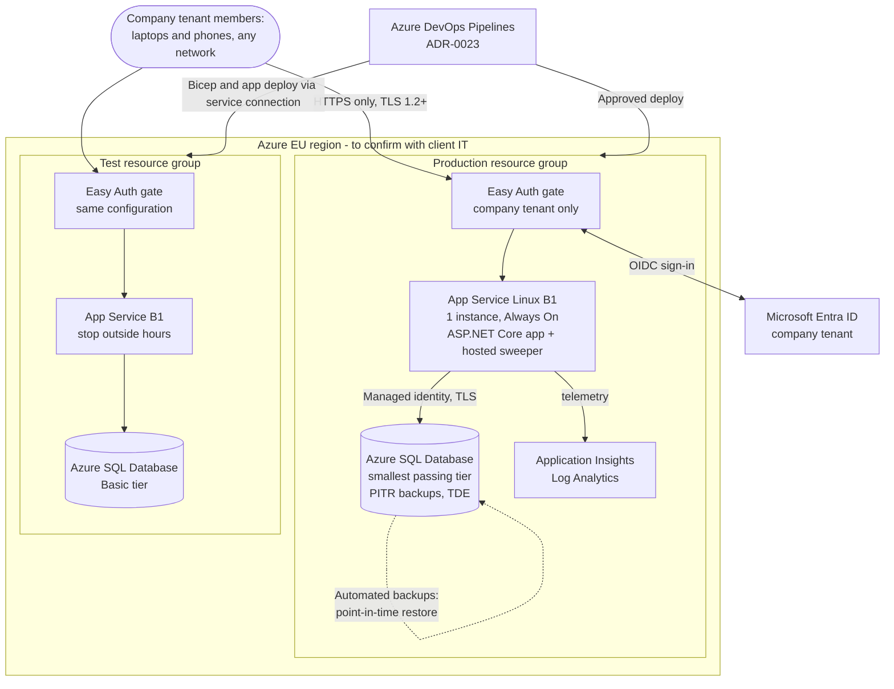

Deployment notes:

- **Region.** An EU Azure region *(Source: ADR-0015, decision 2)*; candidates West Europe or Germany West Central, confirmed with client IT (ADR-0017, Proposed).
- **Availability.** Single instance, best effort during office hours (NFR-007). No zone redundancy; deploy outside office hours.
- **Backup and recovery.** Azure SQL automated backups with point-in-time restore satisfy RPO 24 hours and RTO one business day (NFR-008), with the restore procedure rehearsed once before go-live. The environment is recreated from Bicep.
- **Transport and storage.** HTTPS only, minimum TLS 1.2, HTTP redirected; the database encrypts data at rest by default (NFR-011).
- **Secrets.** Managed identity to the database, so no database password. The cookie key ring is persisted in the database so restarts and redeployments do not log everyone out. Any client secret for the gate app registration is an App Service setting or Key Vault reference.
- **Access gating.** The Easy Auth gate is configured on both production and test as code, requiring authentication on every path except a platform health check. Other App Service endpoints such as the deployment console are secured separately. No exposure with real data until the gate is verified.
- **Privacy note.** A static page states what is stored, why, who can see it, how long (NFR-021), and whom to contact. Text to be agreed with Office Operations *(Source: ADR-0015, decision 2)*.
- **Environments.** Test and production. No clock control exists in any environment; the injectable clock is used only by automated tests. Automated tests reach the gated test environment with a pipeline service principal token.
- **Switch from SQLite.** Generate an Azure SQL baseline migration; apply `rowversion` and the case-insensitive collation; implement the UPDLOCK per-room lock; re-run the concurrency and collation integration tests on Azure SQL; verify no `DateTimeOffset` or provider-specific type crept into the model (ADR-0025).

## Open Questions

**POC phase**

- [x] Resolved 2026-09-29 (ADR-0024): the delivery team demonstrates; no remote client access and no live trial.
- [x] Resolved 2026-09-29 (ADR-0024): the delivery team prepares the sample import CSV and the synthetic people and bookings before development ends.
- [x] Resolved 2026-09-29 (ADR-0024): no demonstration clock control; the real clock is used, and the injectable clock is for automated tests only.
- [ ] Confirm the bootstrap admin settings (name and email) to be used for the demonstration. Owner: delivery team with project lead.
- [ ] Confirm the exact IANA time zone name (assumed Europe/Berlin) with Office Operations. Owner: project lead.
- [ ] Client confirmation of ADR-0011 to ADR-0013 and of ADR-0015. Owner: project lead.
- [ ] Verify the SQLite immediate-transaction API, WAL and busy-timeout settings at build start. Owner: delivery team.

**Post-POC (parked)**

- [ ] Trigger, owner and date for starting the hosted phase. Owner: project lead.
- [ ] Choose the Azure EU region and confirm subscription, policies and cost centre with client IT (ADR-0017). Owner: project lead with client IT.
- [ ] Can client IT create the single-tenant Entra app registration for the gate (ADR-0021), which tenant is the company tenant, can user assignment be required, and would Conditional Access block personal phones? Owner: client IT.
- [ ] Where do the Azure DevOps organisation and source repository live (ADR-0023), and who provides the deployment service connection? Owner: project lead with client IT.
- [ ] Agree the privacy note wording and any company data policy. Owner: Office Operations.
- [ ] Availability and backup assumptions (NFR-007, NFR-008) acceptable? Owner: Office Operations.
- [ ] Is Microsoft Entra ID the exact future provider for in-app sign-in? Owner: client IT.

## Risks

| # | Risk | Likelihood | Impact | Mitigation |
|---|------|------------|--------|------------|
| 1 | POC is shared or exposed beyond localhost (public tunnel, shared LAN binding), leaving the picker open | Low | Medium | Bind to localhost only; no tunnels (ADR-0024); synthetic data only, so exposure impact is limited |
| 2 | SQLite behaviour masks SQL Server issues (locking, collation, `rowversion`, date handling) | Medium | Medium | Provider-neutral model; guard test against provider-specific types; repeat concurrency and collation tests on Azure SQL before hosting (ADR-0025) |
| 3 | Any picker user can act as an admin | High (by design) | Low in POC | Accepted by ADR-0005; POC is a controlled demonstration with fictional people; gate and audit attribution apply when hosted |
| 4 | Hosted-phase dependencies (client IT approval for the app registration, subscription, service connection) are discovered late | Medium | High | Recorded as parked open questions; raise with client IT when the hosted phase is planned; ADR-0021 must be reopened if refused |
| 5 | Spreadsheet data is dirty and many rows are rejected | Medium | Medium | Rejection report; Office Operations owns clean-up (ADR-0012, Proposed); POC uses an anonymised sample |
| 6 | Time zone assumption or DST handling wrong | Low | Medium | Zone configurable; fake-clock DST tests; confirm zone name |
| 7 | Sweeper not running when the POC is stopped | Low | Low | Effective status on read keeps rules correct; sweeper catches up on start |
| 8 | Rules confirmed only by the project lead differ from client expectation | Low | Medium | Show ADR-0014 and ADR-0015 to Office Operations at the demonstration |
| 9 | Parked infrastructure decisions drift or are forgotten | Medium | Medium | Target state section and ADR change logs record the deferral; owner and trigger for the post-POC phase to be defined (ADR-0024) |
| 10 | Client mistakes the POC for a production-ready product | Medium | Medium | State clearly in the demonstration that it is a local POC on synthetic data with no sign-in and no hosting |

## Sources

- *Sources: room-booking-spec.md; client-qa-2026-09-29.md*
- *Source: intake-meeting-room-booking-2026-09-29.md*
- *Sources: .project/product-definition/modules (M-01 to M-06), scope.md, nfrs.md, e2e-scenarios.md, integration-points.md*
- *Sources: ADR-0001 to ADR-0025 (ADR-0011 to ADR-0013, ADR-0017 to ADR-0020 and ADR-0022 Proposed)*
- *Source: arch-meeting-room-booking-v1.1.md (target-state material carried forward)*
- *Source: project lead, working session 2026-09-29 (local POC scope change; off-network requirement; .NET; Azure DevOps)*
