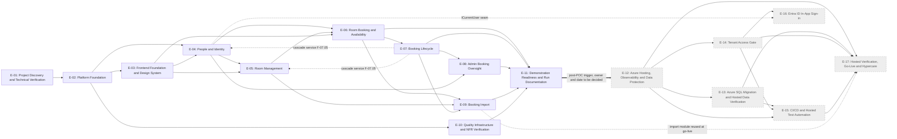

# Work Breakdown Structure: Meeting Room Booking

**Version:** 1.0
**Date:** 2026-09-29
**Status:** Draft (not yet validated; Phase 8 `validate-backlog` is the next step)
**Current phase:** Local POC (ADR-0024). Post-POC work is decomposed and traceable but Deferred.
**Stack option reflected:** No option A/B consolidation ADR exists; the backlog reflects the POC stack (ASP.NET Core Razor Pages modular monolith, EF Core, SQLite, ADR-0016, ADR-0025) with Azure SQL as the deferred target.

**Source documents:**

- Proposal: none exists yet (Phase 11). Scope is taken from `.project/product-definition/scope.md` and modules M-01 to M-06 (see Coverage Notes).
- Architecture: `arch-meeting-room-booking-v1.2.md`, `security-assessment-meeting-room-booking-v1.2.md`, `test-strategy-meeting-room-booking-v1.2.md` (v1.0 and v1.1 are superseded); `integration-spreadsheet-csv-import-v1.0.md`, `integration-microsoft-entra-id-v1.0.md`
- Data model: `.project/data-model/` (README, domain files, `data-model.json`)
- UI designs: `.project/ui-designs/README.md`, `design-direction.md`, canvas https://claude.ai/artifact/To59cLQHzaCeyPeWuDtcNa
- ADRs: 25 in total — 17 accepted, 8 proposed (ADR-0011, 0012, 0013, 0017, 0018, 0019, 0020, 0022), 0 open, 0 conflict
- Formal documents: `room-booking-spec.md`, `client-qa-2026-09-29.md`, intake record `intake-meeting-room-booking-2026-09-29.md`, `project-context.md`, `nfrs.md`, `e2e-scenarios.md`, `integration-points.md`

**Conventions used in this WBS**

- **Personas.** Stories use only the delivery personas allowed by the `create-work-breakdown` skill (Software Engineer, QA Engineer, Program Architect, Program Manager). The business role served (employee, admin) appears in the "so that" clause and in the acceptance criteria.
- **Estimates.** All `PD Estimate` and `Estimated Hours` fields are `TBD`. Estimation is Phase 9.
- **Feature state.** Every feature file carries the front-matter block from the Backlog State and Change Management rules. POC features are `Planned`; post-POC features are `Deferred` with `Deferred To: Post-POC` and live in `features/_deferred/`.
- **Tests.** No "testing" stories exist. QA derives tests from each story's acceptance criteria; E-10 builds only the shared test infrastructure and NFR tooling.

---

## Summary

| #         | EPIC                                                    | Features | Stories | Delivery Phase(s)                 | Key Dependencies |
| --------- | ------------------------------------------------------- | -------- | ------- | --------------------------------- | ---------------- |
| E-01      | Project Discovery and Technical Verification            | 3        | 9       | Phase 1 — POC (Discovery)         | none |
| E-02      | Platform Foundation                                     | 7        | 27      | Phase 1 — POC                     | E-01 |
| E-03      | Frontend Foundation and Design System                   | 4        | 15      | Phase 1 — POC                     | E-02 |
| E-04      | People and Identity (M-04)                              | 3        | 14      | Phase 1 — POC                     | E-02, E-03; S-04.01.03 also F-07.05 |
| E-05      | Room Management (M-03)                                  | 2        | 8       | Phase 1 — POC                     | E-02, E-03, E-04; F-05.02 also F-07.05 |
| E-06      | Room Booking and Availability (M-01)                    | 6        | 24      | Phase 1 — POC                     | E-02, E-03, E-04, E-05 |
| E-07      | Booking Lifecycle (M-02)                                | 5        | 21      | Phase 1 — POC                     | E-06 |
| E-08      | Admin Booking Oversight (M-05)                          | 3        | 11      | Phase 1 — POC                     | E-04, E-06, E-07 |
| E-09      | Booking Import (M-06)                                   | 6        | 22      | Phase 1 — POC                     | E-05, E-06, E-07 |
| E-10      | Quality Infrastructure and NFR Verification Tooling     | 2        | 7       | Phase 1 — POC (cross-cutting)     | E-02 |
| E-11      | Demonstration Readiness and Run Documentation           | 3        | 8       | Phase 1 — POC (close-out)         | E-06 to E-10 |
| **POC subtotal** |                                                  | **44**   | **166** |                                   | |
| E-12      | Azure Hosting, Observability and Data Protection        | 4        | 12      | Post-POC (Deferred)               | POC complete, client IT |
| E-13      | Azure SQL Migration and Hosted Data Verification        | 3        | 9       | Post-POC (Deferred)               | E-12 |
| E-14      | Tenant Access Gate                                      | 3        | 9       | Post-POC (Deferred)               | E-12, client IT |
| E-15      | CI/CD and Hosted Test Automation                        | 3        | 10      | Post-POC (Deferred)               | E-12, E-13, E-14 |
| E-16      | Entra ID In-App Sign-in                                 | 2        | 5       | Post-POC (Deferred, later phase)  | E-12, E-14 |
| E-17      | Hosted Verification, Go-Live and Hypercare              | 3        | 9       | Post-POC (Deferred)               | E-12 to E-15 |
| **Deferred subtotal** |                                             | **18**   | **54**  |                                   | |
| **Total** | **17 EPICs**                                            | **62 Features** | **220 Stories** |                        | |

POC: 11 EPICs, 44 Features, 166 Stories (files in `features/`). Deferred: 6 EPICs, 18 Features, 54 Stories (files in `features/_deferred/`).

---

## Dependency Map

Solid arrows are hard dependencies. Dotted arrows are cross-EPIC service dependencies that are sequenced feature by feature (the cascade service F-07.05 is built in E-07 and consumed by the deactivation stories in E-04 and E-05, so the person-deactivation and room-deactivation stories are scheduled after F-07.05). Post-POC EPICs are shaded as deferred.

**Critical path (POC):** E-01 (Discovery) → E-02 (foundation) → E-04 (identity) → E-05/E-06 (rooms, rules and write service) → E-07 (lifecycle) → E-09 (import) → E-11 (demonstration readiness). E-03 (frontend foundation) and E-10 (test infrastructure) run in parallel after E-02 but gate the UI stories and story-level tests. Parallelism and calendar shape are decided in Phase 10.

---

## EPIC Details

### E-01: Project Discovery and Technical Verification

**Description:** The standalone Discovery phase of the POC. Retires the technical unknowns the architecture flagged (SQLite immediate transaction, time zone data, timeline UI approach) and records dispositions for Proposed ADRs and open build-start items.
**Delivery Phase:** Phase 1 — POC (Discovery)
**Dependencies:** none

> Full detail: [E-01-project-discovery-and-technical-verification.md](epics/E-01-project-discovery-and-technical-verification.md)

| Feature | Description | Stories | Surfaces |
|---------|-------------|---------|----------|
| [F-01.01: Technical Spikes and Stack Verification](features/F-01.01-technical-spikes-and-stack-verification.md) | Proves SQLite concurrency, time zone data and the timeline UI approach | 4 | Engineering |
| [F-01.02: Proposed ADR and Open Item Resolution](features/F-01.02-proposed-adr-and-open-item-resolution.md) | Confirmation pack for ADR-0011 to ADR-0015 and dispositions for Proposed technical ADRs | 3 | Engineering |
| [F-01.03: Import Format Template and Sample Request](features/F-01.03-import-format-template-and-sample-request.md) | CSV template and anonymised-export request for Office Operations | 2 | Engineering |

---

### E-02: Platform Foundation

**Description:** Infrastructure-first EPIC: solution scaffold, all entities and migrations on SQLite, office clock, audit recorder, first-admin bootstrap, seed data, localhost-only hosting and security baseline. Claims the shared seams so later stories never redefine them.
**Delivery Phase:** Phase 1 — POC
**Dependencies:** E-01

> Full detail: [E-02-platform-foundation.md](epics/E-02-platform-foundation.md)

| Feature | Description | Stories | Surfaces |
|---------|-------------|---------|----------|
| [F-02.01: Solution Scaffold and Module Structure](features/F-02.01-solution-scaffold-and-module-structure.md) | Solution, modules, configuration, logging, boundary enforcement | 4 | Engineering |
| [F-02.02: Persistence Foundation (EF Core and SQLite)](features/F-02.02-persistence-foundation-ef-core-sqlite.md) | All entities, SQLite configuration, indexes, migrations, neutrality guard | 5 | Engineering |
| [F-02.03: Office Clock and Time Handling](features/F-02.03-office-clock-and-time-handling.md) | Clock, office-zone conversions, no clock control | 4 | Engineering, Web |
| [F-02.04: Audit Trail Recorder](features/F-02.04-audit-trail-recorder.md) | Append-only audit in the change transaction | 3 | Engineering |
| [F-02.05: First-Admin Bootstrap](features/F-02.05-first-admin-bootstrap.md) | Configured, idempotent, fail-fast first admin | 3 | Engineering |
| [F-02.06: Seed Data (Rooms, People, Demonstration Bookings)](features/F-02.06-seed-data-rooms-people-and-demonstration-bookings.md) | Rooms exactly as specified, synthetic people and bookings | 4 | Engineering |
| [F-02.07: Localhost Hosting and Local Security Baseline](features/F-02.07-localhost-hosting-and-local-security-baseline.md) | Loopback binding, anti-forgery, limits, key ring | 4 | Engineering, Web |

---

### E-03: Frontend Foundation and Design System

**Description:** Implements the approved design direction: tokens, component library, application shell and navigation, and the shared states, responsive and accessibility patterns.
**Delivery Phase:** Phase 1 — POC
**Dependencies:** E-02

> Full detail: [E-03-frontend-foundation-and-design-system.md](epics/E-03-frontend-foundation-and-design-system.md)

| Feature | Description | Stories | Surfaces |
|---------|-------------|---------|----------|
| [F-03.01: Design Tokens and Base Styles](features/F-03.01-design-tokens-and-base-styles.md) | Colour, type, spacing, elevation, motion, base detail | 3 | Web, Phone browser |
| [F-03.02: Component Library](features/F-03.02-component-library.md) | Status vocabulary, controls, surfaces, feedback | 4 | Web, Phone browser |
| [F-03.03: Application Shell and Navigation](features/F-03.03-application-shell-and-navigation.md) | Navbar, tab bar, admin hub, role-aware navigation | 4 | Web, Phone browser |
| [F-03.04: States, Responsive Behaviour and Accessibility Baseline](features/F-03.04-states-responsive-behaviour-and-accessibility-baseline.md) | State patterns, responsive behaviour, accessibility, error pages | 4 | Web, Phone browser |

---

### E-04: People and Identity (M-04)

**Description:** Admin-managed people directory, pick-a-user with the `ICurrentUser` seam, and server-side role and privacy enforcement.
**Delivery Phase:** Phase 1 — POC
**Dependencies:** E-02, E-03; S-04.01.03 also depends on F-07.05

> Full detail: [E-04-people-and-identity.md](epics/E-04-people-and-identity.md)

| Feature | Description | Stories | Surfaces |
|---------|-------------|---------|----------|
| [F-04.01: People Management](features/F-04.01-people-management.md) | Add, edit, deactivate, reactivate people | 5 | Web, Phone browser, Admin |
| [F-04.02: Pick-a-User and Current-User Seam](features/F-04.02-pick-a-user-and-current-user-seam.md) | `ICurrentUser`, picker, switch user, stale identity, cookie hardening | 5 | Web, Phone browser |
| [F-04.03: Role-based Authorisation and Privacy Enforcement](features/F-04.03-role-based-authorisation-and-privacy-enforcement.md) | Deny-by-default policies, ownership, privacy read models, refusals | 4 | Web, Phone browser |

---

### E-05: Room Management (M-03)

**Description:** Admin maintenance of rooms and safe deactivation and reactivation.
**Delivery Phase:** Phase 1 — POC
**Dependencies:** E-02, E-03, E-04; F-05.02 also depends on F-07.05

> Full detail: [E-05-room-management.md](epics/E-05-room-management.md)

| Feature | Description | Stories | Surfaces |
|---------|-------------|---------|----------|
| [F-05.01: Room Maintenance](features/F-05.01-room-maintenance.md) | Add, rename, capacity, list, screens | 4 | Web, Phone browser, Admin |
| [F-05.02: Room Deactivation and Reactivation](features/F-05.02-room-deactivation-and-reactivation.md) | Deactivation with cascade, exclusion, reactivation | 4 | Web, Phone browser, Admin |

---

### E-06: Room Booking and Availability (M-01)

**Description:** Booking rules engine, single write service with SQLite concurrency control, availability search and timeline board, create booking (self, on behalf, admin for self), remainder rebooking and My bookings.
**Delivery Phase:** Phase 1 — POC
**Dependencies:** E-02, E-03, E-04, E-05

> Full detail: [E-06-room-booking-and-availability.md](epics/E-06-room-booking-and-availability.md)

| Feature | Description | Stories | Surfaces |
|---------|-------------|---------|----------|
| [F-06.01: Booking Rules Engine](features/F-06.01-booking-rules-engine.md) | Pure rule set with named refusals | 5 | Engineering |
| [F-06.02: Booking Write Service and Concurrency Control](features/F-06.02-booking-write-service-and-concurrency-control.md) | Single write path and no double booking | 4 | Engineering |
| [F-06.03: Availability Search and View](features/F-06.03-availability-search-and-view.md) | Availability query, privacy read model, timeline board, phone list | 4 | Web, Phone browser |
| [F-06.04: Create Booking](features/F-06.04-create-booking.md) | Book for self, on behalf, admin for self, drawer and phone flow | 5 | Web, Phone browser |
| [F-06.05: Rebook Freed No-show Remainder](features/F-06.05-rebook-freed-no-show-remainder.md) | Bookable remainder on the 15-minute grid | 3 | Web, Phone browser |
| [F-06.06: My Bookings List](features/F-06.06-my-bookings-list.md) | Own bookings with status | 3 | Web, Phone browser |

---

### E-07: Booking Lifecycle (M-02)

**Description:** Edit, cancel with late flag, owner-only check-in, sweeper for no-show and done, and the shared deactivation cascade.
**Delivery Phase:** Phase 1 — POC
**Dependencies:** E-06

> Full detail: [E-07-booking-lifecycle.md](epics/E-07-booking-lifecycle.md)

| Feature | Description | Stories | Surfaces |
|---------|-------------|---------|----------|
| [F-07.01: Edit Booking](features/F-07.01-edit-booking.md) | Edit with full re-validation | 4 | Web, Phone browser |
| [F-07.02: Cancel Booking and Late Cancellation Flag](features/F-07.02-cancel-booking-and-late-cancellation-flag.md) | Owner and admin cancellation, late flag | 5 | Web, Phone browser |
| [F-07.03: Check-in](features/F-07.03-check-in.md) | Owner-only window and phone-first UI | 4 | Web, Phone browser |
| [F-07.04: Status Sweeper (No-show and Done)](features/F-07.04-status-sweeper-no-show-and-done.md) | Background transitions and effective status | 4 | Engineering |
| [F-07.05: Deactivation Cascade Cancellation](features/F-07.05-deactivation-cascade-cancellation.md) | Shared cascade for room and person deactivation | 4 | Engineering, Web |

---

### E-08: Admin Booking Oversight (M-05)

**Description:** All-bookings list with filters, late-cancellation and no-show review with counts, and admin actions from the list.
**Delivery Phase:** Phase 1 — POC
**Dependencies:** E-04, E-06, E-07

> Full detail: [E-08-admin-booking-oversight.md](epics/E-08-admin-booking-oversight.md)

| Feature | Description | Stories | Surfaces |
|---------|-------------|---------|----------|
| [F-08.01: All Bookings List and Filters](features/F-08.01-all-bookings-list-and-filters.md) | Admin list and filters | 4 | Web, Phone browser, Admin |
| [F-08.02: Late Cancellation and No-show Review](features/F-08.02-late-cancellation-and-no-show-review.md) | Review views with counts, review-only guarantee | 4 | Web, Phone browser, Admin |
| [F-08.03: Admin Actions from the Booking List](features/F-08.03-admin-actions-from-the-booking-list.md) | Cancel or edit from the list | 3 | Web, Phone browser, Admin |

---

### E-09: Booking Import (M-06)

**Description:** Complete one-off CSV import: intake checks, window and validation, execution with duplicate detection, rejected-rows report with escaped download and settle and purge, screens and the sample CSV.
**Delivery Phase:** Phase 1 — POC
**Dependencies:** E-05, E-06, E-07 (Proposed ADR-0011 to ADR-0013 pending confirmation)

> Full detail: [E-09-booking-import.md](epics/E-09-booking-import.md)

| Feature | Description | Stories | Surfaces |
|---------|-------------|---------|----------|
| [F-09.01: Import Page and File Intake](features/F-09.01-import-page-and-file-intake.md) | Admin page, whole-file checks, parsing | 4 | Web, Phone browser, Admin |
| [F-09.02: Import Window and Row Validation](features/F-09.02-import-window-and-row-validation.md) | Window, formats, references, rules, ordering | 4 | Engineering |
| [F-09.03: Import Execution and Re-import](features/F-09.03-import-execution-and-re-import.md) | Write rows, duplicates, run bookkeeping, performance | 4 | Engineering |
| [F-09.04: Rejected-Rows Report and Downloadable CSV](features/F-09.04-rejected-rows-report-and-downloadable-csv.md) | Report, download, escaping, settle and purge | 4 | Web, Admin |
| [F-09.05: Import Screens (Web and Phone)](features/F-09.05-import-screens-web-and-phone.md) | Upload, result and states screens | 3 | Web, Phone browser, Admin |
| [F-09.06: Sample Import CSV and Fixtures](features/F-09.06-sample-import-csv-and-fixtures.md) | Synthetic sample covering every rejection reason | 3 | Engineering |

---

### E-10: Quality Infrastructure and NFR Verification Tooling

**Description:** Local test harnesses (integration, API, E2E), builders and helpers, bulk data generators, optional k6 and ZAP, and the dependency check.
**Delivery Phase:** Phase 1 — POC (cross-cutting)
**Dependencies:** E-02

> Full detail: [E-10-quality-infrastructure-and-nfr-verification.md](epics/E-10-quality-infrastructure-and-nfr-verification.md)

| Feature | Description | Stories | Surfaces |
|---------|-------------|---------|----------|
| [F-10.01: Test Harness and Fixtures](features/F-10.01-test-harness-and-fixtures.md) | Integration, API and E2E fixtures and helpers | 4 | Engineering |
| [F-10.02: Local NFR Verification Tooling](features/F-10.02-local-nfr-verification-tooling.md) | Bulk data, optional k6 and ZAP, dependency check | 3 | Engineering |

---

### E-11: Demonstration Readiness and Run Documentation

**Description:** Run guide with localhost-only safeguards, demonstration script and checklist, POC statement, and post-POC handoff register.
**Delivery Phase:** Phase 1 — POC (close-out)
**Dependencies:** E-06 to E-10

> Full detail: [E-11-demonstration-readiness-and-run-documentation.md](epics/E-11-demonstration-readiness-and-run-documentation.md)

| Feature | Description | Stories | Surfaces |
|---------|-------------|---------|----------|
| [F-11.01: Local Run Guide and Safeguards](features/F-11.01-local-run-guide-and-safeguards.md) | Run, reset, configuration, SEC-13 and SEC-14 safeguards | 3 | Documentation |
| [F-11.02: Demonstration Pack](features/F-11.02-demonstration-pack.md) | Script, checklist, POC statement, confirmations | 3 | Documentation |
| [F-11.03: Post-POC Handoff Register](features/F-11.03-post-poc-handoff-register.md) | Deferred items register and feedback capture | 2 | Documentation |

---

### E-12: Azure Hosting, Observability and Data Protection (Deferred — Post-POC)

**Description:** Azure environments as code in an EU region, App Service configuration, managed identity, Application Insights, privacy note, backups.
**Delivery Phase:** Post-POC
**Dependencies:** POC complete; client IT

> Full detail: [E-12-azure-hosting-observability-and-data-protection.md](epics/E-12-azure-hosting-observability-and-data-protection.md)

| Feature | Description | Stories | Surfaces |
|---------|-------------|---------|----------|
| [F-12.01: Azure Environment and Infrastructure as Code](features/_deferred/F-12.01-azure-environment-and-infrastructure-as-code.md) | Subscription, region, Bicep, App Service, identity | 4 | Azure |
| [F-12.02: Application Insights and Hosted Logging](features/_deferred/F-12.02-application-insights-and-hosted-logging.md) | Telemetry, log discipline, uptime probe | 3 | Azure |
| [F-12.03: EU Region and Privacy Note](features/_deferred/F-12.03-eu-region-and-privacy-note.md) | Privacy note and residency | 3 | Web, Azure |
| [F-12.04: Backup and Recovery Configuration](features/_deferred/F-12.04-backup-and-recovery-configuration.md) | Backups and recovery runbook | 2 | Azure |

---

### E-13: Azure SQL Migration and Hosted Data Verification (Deferred — Post-POC)

**Description:** Provider switch to Azure SQL, per-room lock, and re-verification of engine-dependent behaviour.
**Delivery Phase:** Post-POC
**Dependencies:** E-12

> Full detail: [E-13-azure-sql-migration-and-hosted-data-verification.md](epics/E-13-azure-sql-migration-and-hosted-data-verification.md)

| Feature | Description | Stories | Surfaces |
|---------|-------------|---------|----------|
| [F-13.01: Azure SQL Provider Switch](features/_deferred/F-13.01-azure-sql-provider-switch.md) | Baseline migration, provider selection, hosted seeding | 3 | Engineering |
| [F-13.02: Per-room Lock Concurrency](features/_deferred/F-13.02-per-room-lock-concurrency.md) | UPDLOCK per-room lock and proof | 3 | Engineering |
| [F-13.03: SQL Server Behaviour Re-verification](features/_deferred/F-13.03-sql-server-behaviour-re-verification.md) | Collation, time, lifecycle on SQL Server | 3 | Engineering |

---

### E-14: Tenant Access Gate (Deferred — Post-POC)

**Description:** Easy Auth tenant-only gate, gate identity audit capture, and off-network verification.
**Delivery Phase:** Post-POC (before any hosted deployment with real data)
**Dependencies:** E-12; client IT

> Full detail: [E-14-tenant-access-gate.md](epics/E-14-tenant-access-gate.md)

| Feature | Description | Stories | Surfaces |
|---------|-------------|---------|----------|
| [F-14.01: Easy Auth Gate Configuration](features/_deferred/F-14.01-easy-auth-gate-configuration.md) | Registration, gate as code, hardening, reachability check | 4 | Azure |
| [F-14.02: Gate Identity Audit Capture](features/_deferred/F-14.02-gate-identity-audit-capture.md) | Reader, audit fields, mismatch | 3 | Web, Engineering |
| [F-14.03: Conditional Access and Off-network Verification](features/_deferred/F-14.03-conditional-access-and-off-network-verification.md) | Phone checks and onboarding | 2 | Azure |

---

### E-15: CI/CD and Hosted Test Automation (Deferred — Post-POC)

**Description:** Azure DevOps organisation, repository, service connection, multi-stage pipelines and hosted performance and security testing.
**Delivery Phase:** Post-POC
**Dependencies:** E-12, E-13, E-14

> Full detail: [E-15-ci-cd-and-hosted-test-automation.md](epics/E-15-ci-cd-and-hosted-test-automation.md)

| Feature | Description | Stories | Surfaces |
|---------|-------------|---------|----------|
| [F-15.01: Azure DevOps Organisation, Repository and Service Connection](features/_deferred/F-15.01-azure-devops-organisation-repository-and-service-connection.md) | Platform setup | 3 | Azure DevOps |
| [F-15.02: Multi-stage Pipelines](features/_deferred/F-15.02-multi-stage-pipelines.md) | PR validation, deploy to test, production approval, gate access | 4 | Azure DevOps |
| [F-15.03: Hosted Performance and Security Testing](features/_deferred/F-15.03-hosted-performance-and-security-testing.md) | Nightly k6, ZAP, CI scanning | 3 | Azure DevOps |

---

### E-16: Entra ID In-App Sign-in (Deferred — Post-POC, later phase)

**Description:** OIDC implementation of `ICurrentUser`, safe account linking, picker retirement.
**Delivery Phase:** Post-POC (sign-in phase)
**Dependencies:** E-12, E-14; `ICurrentUser` seam from E-04

> Full detail: [E-16-entra-id-in-app-sign-in.md](epics/E-16-entra-id-in-app-sign-in.md)

| Feature | Description | Stories | Surfaces |
|---------|-------------|---------|----------|
| [F-16.01: Entra ID Current-User Implementation](features/_deferred/F-16.01-entra-id-current-user-implementation.md) | OIDC, linking, roles in database | 3 | Web, Phone browser |
| [F-16.02: Sign-in Cutover and Picker Retirement](features/_deferred/F-16.02-sign-in-cutover-and-picker-retirement.md) | Switch, retire picker, verify | 2 | Web, Phone browser |

---

### E-17: Hosted Verification, Go-Live and Hypercare (Deferred — Post-POC)

**Description:** Pre-go-live verification, real-data import and cutover, and one week of hypercare.
**Delivery Phase:** Post-POC
**Dependencies:** E-12, E-13, E-14, E-15

> Full detail: [E-17-hosted-verification-go-live-and-hypercare.md](epics/E-17-hosted-verification-go-live-and-hypercare.md)

| Feature | Description | Stories | Surfaces |
|---------|-------------|---------|----------|
| [F-17.01: Pre-go-live Verification](features/_deferred/F-17.01-pre-go-live-verification.md) | Security re-assessment, restore rehearsal, hosted baselines | 4 | Azure |
| [F-17.02: Pilot Go-live Import and Cutover](features/_deferred/F-17.02-pilot-go-live-import-and-cutover.md) | Real import, spreadsheet retirement | 3 | Web, Admin |
| [F-17.03: Hypercare](features/_deferred/F-17.03-hypercare.md) | One-week triage and handover | 2 | Azure |

---

## Traceability Matrix

### Product Module → EPIC Mapping

No proposal exists yet; the product definition modules are the reference.

| Module | EPIC(s) | Coverage notes |
|--------|---------|----------------|
| M-01 Room Booking and Availability | E-06 (primary), E-03 (UI), E-02 (clock, persistence) | Rules engine, write service, availability, create booking, remainder rebooking, My bookings |
| M-02 Booking Lifecycle | E-07 (primary), E-06 (My bookings host) | Edit, cancel, check-in, sweeper, deactivation cascade |
| M-03 Room Management | E-05 (primary), E-02 (seed), E-07 (cascade) | Maintenance and safe deactivation |
| M-04 People and Identity | E-04 (primary), E-02 (bootstrap, seed), E-07 (cascade) | People, picker, `ICurrentUser`, authorisation |
| M-05 Admin Booking Oversight | E-08 | List, review, actions |
| M-06 Booking Import | E-09 (primary), E-01 (template, sample request) | Complete in the POC; format pending client confirmation |
| Cross-cutting: foundation, UI, quality, demonstration | E-02, E-03, E-10, E-11 | Infrastructure-first foundation, design system, harness, run documentation |
| Post-POC: hosting, gate, SQL, CI/CD, sign-in, go-live | E-12 to E-17 | Deferred, traceable |

### Scope Item → Feature Mapping (scope.md)

| Scope item (In Scope) | Feature(s) |
|-----------------------|-----------|
| Availability search, busy without booker | F-06.03 |
| Create booking with all rules | F-06.01, F-06.02, F-06.04 |
| 3-booking limit, admin on behalf, admin for self | F-06.01 (S-06.01.04), F-06.04 |
| Edit unstarted bookings, never late, not counted | F-07.01 |
| Cancel and late flag | F-07.02 |
| Check-in from own device | F-07.03 |
| No-show, remainder rebooking, done | F-07.04, F-06.05 |
| Room management incl. deactivation cascade | F-05.01, F-05.02, F-07.05 |
| People management incl. deactivation cascade | F-04.01, F-07.05 |
| Pick-a-user active only, role-based privacy | F-04.02, F-04.03 |
| Admin oversight, late and no-show review | F-08.01, F-08.02, F-08.03 |
| CSV import with rejection report | E-09 (F-09.01 to F-09.06) |
| Web app for desktop and phone browsers | E-03 |
| Initial rooms data | F-02.06 |
| Hosted on Azure (target, deferred) | E-12 |

### ADR → Feature Mapping

| ADR | Title | Status | Feature(s) | Implementation notes |
|-----|-------|--------|------------|----------------------|
| ADR-0001 | Pilot scope and user base | Accepted | F-04.01, F-10.02, F-17.02 | Up to 50 users; bulk data for 50 people; go-live undecided |
| ADR-0002 | Azure hosting | Accepted (deferred) | F-12.01 | Target platform after POC |
| ADR-0003 | Web app and check-in from own device | Accepted | F-07.03, F-03.04, E-03 | Responsive web, phone-first check-in |
| ADR-0004 | Admin-managed people directory | Accepted | F-04.01, F-09.02 | Manual people; import matches existing people |
| ADR-0005 | No login in pilot | Accepted | F-04.02, F-04.03, F-16.02 | Picker, server-side role rules against selected identity |
| ADR-0006 | Microsoft-ready identity, email as key | Accepted | F-02.02, F-04.01, F-16.01 | Case-insensitive unique email |
| ADR-0007 | Employees can edit bookings | Accepted | F-07.01, F-08.02 | Edits never late, invisible to reports |
| ADR-0008 | No-show remainder on 15-minute grid | Accepted | F-06.05, F-07.04 | Remainder bookable from the no-show moment |
| ADR-0009 | Admin review only | Accepted | F-08.02 | No automatic penalties |
| ADR-0010 | One-off import of upcoming-week bookings | Accepted | E-09, F-17.02 | Complete in POC; real import at go-live |
| ADR-0011 | CSV import format and rule enforcement | Proposed | F-09.01, F-09.02, F-09.04, F-09.06, F-01.02, F-01.03 | Built as proposed; pending client confirmation |
| ADR-0012 | Office Operations owns clean-up | Proposed | F-01.02, F-01.03, F-17.02 | Assumption recorded; drives no code |
| ADR-0013 | 30-minute minimum on remainder | Proposed | F-06.05 (S-06.05.02), F-01.02 | Ordinary duration rule; isolated for easy reversal |
| ADR-0014 | Edit, limit, import window, deactivation, user-list rules | Accepted | F-06.01, F-07.01, F-07.05, F-04.01, F-04.02, F-09.02 | All five rules mapped |
| ADR-0015 | Time zone, data protection, admin late flag, owner check-in, weekend go-live | Accepted | F-02.03, F-07.02, F-07.03, F-09.02; F-12.03 (deferred part) | Decision 2 operational part deferred |
| ADR-0016 | ASP.NET Core modular monolith with Azure SQL | Accepted | F-02.01, F-02.02, F-13.01 | SQLite now, Azure SQL later |
| ADR-0017 | Azure hosting shape and EU region | Proposed (deferred) | F-12.01 to F-12.04 | Not estimable until client IT input |
| ADR-0018 | Background processing for no-show and done | Proposed | F-07.04 | Built on recommended option |
| ADR-0019 | Office time handling | Proposed | F-02.03, F-02.02 | Built on recommended option |
| ADR-0020 | Concurrency control per-room lock | Proposed | F-06.02 (SQLite adaptation), F-13.02 | Per-room lock deferred |
| ADR-0021 | Pilot access gating | Accepted (deferred) | F-14.01, F-14.02, F-14.03 | Re-activates on hosting |
| ADR-0022 | Current-user seam and Entra path | Proposed | F-04.02 (seam), F-02.01 (enforcement), F-16.01, F-16.02 | Seam in POC; Entra deferred |
| ADR-0023 | Azure DevOps as CI/CD | Accepted (deferred) | F-15.01, F-15.02, F-15.03 | Deferred |
| ADR-0024 | Local POC first | Accepted | E-01, F-02.05, F-02.06, F-02.07, F-02.03, E-11, all deferral | Governs the POC/post-POC split and the bootstrap, seed and no-clock-control rules |
| ADR-0025 | SQLite as POC database | Accepted | F-01.01, F-02.02, F-06.02, F-10.01, F-13.01 to F-13.03 | Provider neutrality, verify at hosting |

### Integration → Feature Mapping

| External system | Integration type | Feature(s) | Readiness |
|-----------------|------------------|------------|-----------|
| Spreadsheet CSV export (Office Operations) | Inbound, one-off file upload | E-09, F-01.03, F-17.02 | Ready with caveats (format and ownership unconfirmed) |
| Microsoft Entra ID — Easy Auth gate | Platform sign-in in front of the app | E-14 | Ready with caveats; deferred; client IT dependency |
| Microsoft Entra ID — in-app sign-in | OpenID Connect, later | E-16 | Ready with caveats; deferred |
| Azure platform services | Platform | E-12, E-13 | Deferred; ADR-0017 Proposed |
| Azure DevOps | Platform | E-15 | Deferred |
| Not integrated (email, calendar, Slack, HR directory, room devices) | — | none by design | Out of scope |

### NFR → Story Mapping

| NFR | Target | Story(s) | Verification approach |
|-----|--------|----------|-----------------------|
| NFR-001 | Up to 50 people | S-04.01.01, S-10.02.01 | Bulk data with 50 people; cap message |
| NFR-002 | A few thousand bookings | S-02.02.03, S-10.02.01 | Indexes; 5,000-booking dataset |
| NFR-003 | Page under 2 s | S-06.03.01, S-10.02.02 | Local timing; optional k6 (indicative) |
| NFR-004 | Import under 1 min | S-09.03.04, S-10.02.01 | 300 and 500 row timing tests |
| NFR-005 | No double booking | S-06.02.02, S-06.02.03; deferred S-13.02.01, S-13.02.02 | Parallel-request integration test |
| NFR-006 | Automatic changes within 1 min | S-07.04.01 to S-07.04.04 | Fake-clock integration tests |
| NFR-007 | Office-hours availability | Deferred S-12.02.03, S-17.01.04 | Uptime probe (post-POC) |
| NFR-008 | RPO 24 h, RTO 1 business day | Deferred S-12.04.01, S-12.04.02, S-17.01.02 | Restore rehearsal (post-POC) |
| NFR-009 | Not exposed beyond trusted group | S-02.07.01, S-11.01.02; deferred S-14.01.02 | Localhost-only check; gate check post-POC |
| NFR-010 | Server-side role enforcement | S-04.03.01, S-04.03.02 | Role-boundary API tests |
| NFR-011 | HTTPS only | Deferred S-12.01.03, S-17.01.04 | Post-POC scan |
| NFR-012 | Privacy | S-04.03.03, S-06.03.02, S-06.06.01 | Boundary tests |
| NFR-013 | Minimal personal data | S-02.06.02, S-02.04.03, S-04.01.01 | Design review; synthetic data only |
| NFR-014 | Data protection | Deferred S-12.03.01, S-12.03.03 | Privacy note review (post-POC) |
| NFR-015 | Single zone with DST | S-02.03.02, S-02.03.04 | DST tests around 25 Oct 2026 and 28 Mar 2027 |
| NFR-016 | Desktop and phone browsers | S-03.04.02, S-10.01.03 | E2E in both viewports |
| NFR-017 | Named refusal reasons | S-06.01.05, S-03.02.02, S-09.02.03 | API tests per acceptance criterion |
| NFR-018 | Accessibility (WCAG 2.1 AA aim) | S-03.04.03, S-10.01.04 | axe checks in E2E |
| NFR-019 | Basic logging | S-02.01.03; deferred S-12.02.01 | Log review |
| NFR-020 | Auditability | S-02.04.01 to S-02.04.03, S-07.01.04, S-07.02.05 | Audit content tests |
| NFR-021 | Retain history | S-02.02.01, S-09.04.04 (purge exception) | Design review |
| NFR-022 | Azure hosting | Deferred S-12.01.02 | Deployment (post-POC) |
| NFR-023 | Case-insensitive unique email | S-02.02.02, S-04.01.01; deferred S-13.03.01 | Duplicate-email test; accented characters post-POC |
| NFR-024 | Low cost | Deferred S-12.01.01 | Cost check post-POC |

### Security Finding → Story Mapping

| Finding | Story(s) | POC status |
|---------|----------|------------|
| SEC-01 | Deferred S-14.01.01 to S-14.01.04 | Not applicable in POC; re-activates on hosting |
| SEC-02 | S-04.02.01, S-04.02.04, S-04.02.05, S-02.07.02 | Applies |
| SEC-03 | S-02.07.02 | Applies |
| SEC-04 | S-04.03.02, S-04.03.03 | Applies |
| SEC-05 | Deferred S-14.02.01 to S-14.02.03 (fields exist, empty, in S-02.04.02) | Deferred |
| SEC-06 | S-09.04.03, S-09.06.01 | Applies |
| SEC-07 | Deferred S-16.01.02 | Not applicable |
| SEC-08 | S-02.07.03, S-09.01.02 | Applies |
| SEC-09 | S-02.01.03, S-02.04.03, S-09.01.04; deferred S-12.02.02 | Log discipline built now |
| SEC-10 | Deferred S-12.01.04 | Deferred |
| SEC-11 | S-02.03.03, S-10.01.03 | Applies |
| SEC-12 | Deferred S-14.01.04 | Not applicable in POC |
| SEC-13 | S-02.07.01, S-11.01.02 | Applies |
| SEC-14 | S-02.06.02, S-09.06.03, S-11.01.02 | Applies |

### E2E Scenario → Feature Mapping

| Scenario | Feature(s) |
|----------|-----------|
| E2E-001 Employee finds and books a room | F-04.02, F-06.03, F-06.04 |
| E2E-002 Back-to-back and overlap | F-06.01, F-06.02 |
| E2E-003 Three-booking limit, edit, cancel | F-06.01, F-07.01, F-07.02 |
| E2E-004 Admin books for others and self | F-06.04 |
| E2E-005 Check in and completion | F-07.03, F-07.04 |
| E2E-006 No-show and remainder | F-07.04, F-06.05 |
| E2E-007 Late and timely cancellation | F-07.02, F-08.02 |
| E2E-008 Started bookings immutable | F-07.01, F-07.02 |
| E2E-009 Admin oversight | F-08.01, F-08.02, F-08.03, F-06.06 |
| E2E-010 Take a room out of use | F-05.02, F-07.05 |
| E2E-011 Add a room, change capacity | F-05.01, F-07.01 |
| E2E-012 People deactivation | F-04.01, F-07.05 |
| E2E-013 First-week import | E-09 (F-09.01 to F-09.06) |
| E2E-014 Privacy and role enforcement | F-04.02, F-04.03 |

### UI Screen → Feature Mapping

| Canvas screens | Feature(s) |
|----------------|-----------|
| Style Guide (Brand, Status, Controls, Navigation, Surfaces) | F-03.01, F-03.02, F-03.03 |
| 01 Entry: S01-pick-user, S01-pick-user-mobile, S01-pick-user-states | F-04.02 |
| 02 Booking: S02-find-room, S02-find-room-mobile | F-06.03 |
| 02 Booking: S02-book-drawer, S02-states | F-06.04, F-07.02 |
| 02 Booking: S02-my-bookings, S02-my-bookings-mobile | F-06.06, F-07.03 |
| 02 Booking: S02-edit-sheet-mobile | F-07.01 |
| 03 Admin: S03-all-bookings (+mobile) | F-08.01 |
| 03 Admin: S03-review (+mobile) | F-08.02 |
| 03 Admin: S03-rooms (+mobile) | F-05.01, F-05.02 |
| 03 Admin: S03-people (+mobile) | F-04.01 |
| 03 Admin: S03-import (+mobile), S03-states | F-09.05 |
| 03 Admin: S03-admin-mobile | F-03.03 |
| 04 Prototype (pick, book Board 10:45, confirm, My bookings) | F-06.04 |

---

## Coverage Notes

**Estimation blockers and dependency flags**

- **Pending client confirmation (Proposed ADRs):** E-09 (all features), F-06.05 (S-06.05.02) and F-01.02 rely on ADR-0011, ADR-0012, ADR-0013. They are estimable on the stated working assumptions; a reversed answer changes M-06 validation or one duration rule. ADR-0014 and ADR-0015 were confirmed by the project lead only.
- **Proposed technical ADRs:** ADR-0018, ADR-0019, ADR-0020 and ADR-0022 are Proposed. F-07.04, F-02.03, F-06.02 and F-04.02 are written on the recommended option; F-01.02 records their disposition.
- **Deferred EPICs are not estimable:** E-12 to E-17 depend on client IT (subscription, region, Entra app registration, service connection), on ADR-0017 being Proposed, and on a post-POC trigger, owner and date that do not exist. They keep `PD Estimate: TBD (Phase 9)` and should be sized only as a rough order of magnitude, if at all, in Phase 9.
- **Integration risk:** F-09.* (CSV file, unseen real spreadsheet); deferred F-14.*, F-16.* (Entra ID, client IT). These need separate integration sizing.

**Decisions taken in this WBS (assumptions to confirm)**

1. **Discovery.** E-01 is a standalone Discovery phase before feature build. Hypercare does not apply to the POC (no go-live, no live trial); it appears as one week in deferred F-17.03, sized at one week for a small single-application pilot. If a later proposal states that support transitions to a separate contract or client operations team, F-17.03 is removed.
2. **Gate identity reader.** Architecture v1.2 keeps the gate identity reader in the component view "empty in the POC". The audit fields are built in the POC (S-02.04.02) but the reader itself is placed in deferred F-14.02 because it has no behaviour without a gate.
3. **Privacy note page.** The component view lists a privacy note page. ADR-0024 defers the operational part of ADR-0015 decision 2, so the page is in deferred F-12.03.
4. **50-person cap.** Enforced as an admin-facing warning, not a block (data model: "enforced as an admin-facing message").
5. **"Import settled".** Defined as an explicit admin action per import run (S-09.04.04); the data model leaves the trigger as a build detail.
6. **Rejected-rows CSV.** The download adds a trailing `reasons` column that the importer ignores, a small extension of ADR-0011 to confirm.
7. **Boundaries.** Check-in at exactly start plus 15 minutes, late cancellation at exactly 2 hours, and CSV whitespace trimming are given working answers in S-01.02.03.
8. **Seed timing.** Demonstration bookings are dated relative to start time inside office hours; when started outside office hours or on a weekend, scenarios are placed on the next working day (S-02.06.03). With no clock control, this is a demonstration constraint the demonstration pack must address (S-11.02.01).
9. **Unit tests.** Developer-owned per the test strategy; no unit-test stories exist. Unit test effort is assumed inside each implementation story's estimate.
10. **Cyclic dependency avoided.** The deactivation cascade (F-07.05) is one service built in E-07 and consumed by E-04 and E-05; stories are sequenced accordingly.

**Gaps noticed in source artifacts**

- **No proposal exists.** The `validate-backlog` traceability checks that cite a proposal (T1, T8, T10) have no proposal to run against; they should use `scope.md` and the modules. Post-launch support (T10) is covered only by deferred E-17.
- **Designs not yet visually verified.** The UI canvas README states that no screen has been visually checked. No design exists for the 403, 404 and 500 pages (F-03.04), the settle-import action and disabled-import state (F-09.05), the web admin hub, or the privacy note page.
- **Scope wording.** `scope.md` (In Scope, Delivery) still says "hosted on Azure"; the POC note in the same file reconciles this. Not a WBS defect but worth cleaning before the proposal.
- **Open items carried forward** from the product definition are unchanged: IANA zone confirmation, in-progress bookings on deactivation, exact-2-hours boundary, and whether admin-on-behalf bookings may exceed the person's limit.

**Validation status:** Not run. Phase 8 (`validate-backlog`) is the next step; expected non-blocking observations are the many features with 3 to 5 stories and the deferred features that intentionally carry lighter detail.

---

## Change Log

| Version | Date | Change |
|---------|------|--------|
| 1.0 | 2026-09-29 | Initial WBS for the local POC (ADR-0024) with post-POC work decomposed and deferred. 17 EPICs, 62 Features, 220 Stories |
