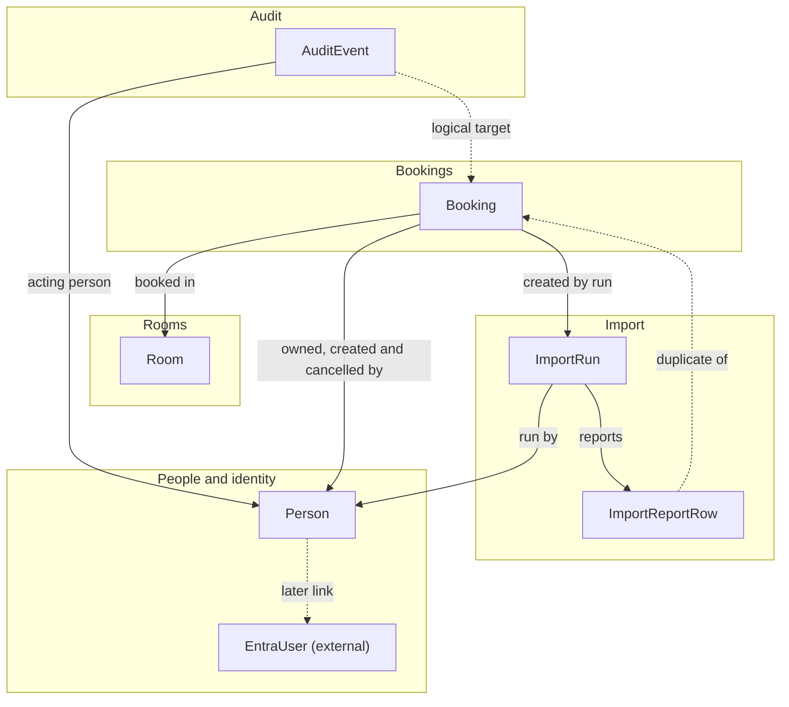

# Meeting Room Booking Pilot — Conceptual Data Model

**Last updated:** 2026-09-29
**Status:** Draft (Phase 5)
**Built from:** arch-meeting-room-booking-v1.1.md, product definition (M-01 to M-06, nfrs.md, e2e-scenarios.md), integration assessments (spreadsheet CSV import; Microsoft Entra ID), ADR-0001 to ADR-0023

Sized for a pilot of up to 50 people, about four rooms and a few thousand bookings. One application owns all data in one database (SQLite in the POC, Azure SQL in the hosted pilot); there is no shared or synchronised external data.

## POC storage note (added 2026-09-29, ADR-0024, ADR-0025)

The current phase is a local POC. **SQLite (through EF Core) is the POC store**; Azure SQL remains the target for the hosted pilot (ADR-0016). This conceptual model is **provider-neutral** and is unchanged: switching providers is a persistence configuration and migration change. The model was checked for SQL Server-only constructs. Nothing prevents it from running on SQLite; four points need a POC mapping:

| Model element | Concern | POC mapping (SQLite) | Azure SQL (target) |
|---------------|---------|----------------------|--------------------|
| `Booking.row_version` (Binary, optimistic concurrency token) | SQLite has no `rowversion`; a value cannot be database-generated | Application-managed concurrency token (for example a GUID or counter replaced on every update, configured as a concurrency token) | `rowversion` |
| `Person.email` and `Room.name` unique, case-insensitive | SQLite compares text case-sensitively by default | Unique index on a `NOCASE` collation (folds ASCII letters only; accented characters are not folded) | Case-insensitive collation |
| All `*_utc` instants (`DateTime (UTC)`) | SQLite has no native date type; `DateTimeOffset` cannot be compared or ordered reliably | UTC `DateTime` stored as ISO-8601 text, with a value converter enforcing `Kind = Utc`. `DateTimeOffset` must not be used. Date-only fields (`ImportRun.go_live_date` and window dates) as ISO date text | `datetime2` and `date` |
| UUID keys | No native type; the "sequential GUID for SQL Server" hint in Conventions has no effect | Stored as text; plain GUIDs | `uniqueidentifier`, optional sequential GUIDs |

Also worth knowing: the per-room lock (ADR-0020) is realised in the POC by SQLite's single-writer serialisation inside one immediate write transaction in the single booking-write service; the JSON-text fields (`AuditEvent.details`, `ImportReportRow.reasons`) are plain text in both engines; filtered or partial unique indexes (the unique `external_identity_object_id` where not empty) are supported by SQLite, and that field is empty in the POC; the `gate_*` audit fields exist and are empty in the POC. Enumerations are stored as strings. No other SQL Server-only feature (computed columns, table-valued types, clustered-index reliance) appears in the model. `data-model.json` needed no structural change; only the `row_version` description was annotated.

## Domains

| Domain | File | Entities | Module(s) |
|--------|------|----------|-----------|
| People and identity | [people-and-identity.md](people-and-identity.md) | Person; EntraUser (external, reference only) | M-04 |
| Rooms | [rooms.md](rooms.md) | Room | M-03 |
| Bookings | [bookings.md](bookings.md) | Booking | M-01, M-02, M-05 (reads), M-06 (writes) |
| Audit | [audit.md](audit.md) | AuditEvent | All (NFR-019, NFR-020) |
| Import | [import.md](import.md) | ImportRun, ImportReportRow | M-06 |

Seven entities in total: six internal and one external. The machine-readable form is [data-model.json](data-model.json), a single JSON Schema with one definition per entity.

## Domain relationships

## Conventions

- **Naming.** Entities in PascalCase; attributes in snake_case (the import CSV columns are already snake_case).
- **Identifiers.** UUID primary keys. The implementation may use a sequential GUID strategy to limit index fragmentation in SQL Server.
- **Time (ADR-0019, Proposed).** Every instant is UTC and named `*_utc`. Office-local values (booking wall-clock times, office hours, the 15-minute grid, the 2-hour late rule, check-in window, import window) are computed by converting through the configured office zone (Europe/Berlin assumed; ADR-0015). The only stored local values are the calendar dates on ImportRun.
- **No deletion.** People and rooms are deactivated; bookings, audit events and import records are retained for the pilot (NFR-021).
- **Email key (ADR-0006, NFR-023).** `Person.email` is unique and case-insensitive via database collation, and is the join point to the import file and the future Microsoft account.
- **Concurrency (ADR-0020, Proposed).** The Room row is the lock target for booking writes and Booking has a `row_version`; no slot table is modelled.
- **Not modelled.** Office time zone, import-enabled switch and go-live date are application configuration. The ASP.NET Core data-protection key ring is a technical table created by the framework, not a domain entity. Recurring meetings, named attendee lists, notifications, holidays, penalties and any uploaded raw file are out of scope.

## Enumerations

| Enumeration | Values | Where |
|-------------|--------|-------|
| Person role | Employee, Admin | Person.role |
| Booking status | Confirmed, CheckedIn, Done, NoShow, Cancelled | Booking.status |
| Cancellation origin | OwnerCancelled, AdminCancelled, RoomDeactivated, PersonDeactivated | Booking.cancellation_origin. Actor type is derived: OwnerCancelled is Owner, the rest are Admin |
| Booking source | Manual, Import | Booking.source |
| Audit actor kind | Person, System | AuditEvent.actor_kind |
| Import outcome | Completed, FileRefused | ImportRun.outcome |
| Report row outcome | Rejected, Duplicate | ImportReportRow.outcome |

The action list for AuditEvent and the rejection rule names for ImportReportRow are in audit.md and import.md.

## Traceability to the product definition

| Requirement source | Where it lands |
|--------------------|----------------|
| Person with role, active flag, email key, future Entra object id (ADR-0004, ADR-0006, ADR-0022) | Person |
| Room with capacity and active flag (M-03) | Room |
| Booking with status lifecycle, times, attendees head count (M-01, M-02) | Booking |
| Late-cancellation flag set only by the owner, admin cancellations never late (ADR-0015 decision 3, AO-03) | Booking.is_late_cancellation, Booking.cancellation_origin |
| "Cancelled by admin" visible to booker, deactivation cascades (LC-12, RM-03, ADR-0014) | Booking.cancellation_origin values RoomDeactivated, PersonDeactivated, AdminCancelled |
| Only the owner checks in (ADR-0015 decision 4); admins book on behalf (BR-09) | Booking.owner_person_id, Booking.created_by_person_id |
| No-show occupies only until the no-show moment; remainder rebookable (ADR-0008) | Booking.no_show_at_utc; a new Booking for the remainder |
| Import batch, rejected-row report, duplicates, window (M-06, ADR-0011, ADR-0014, ADR-0015 decision 5) | ImportRun, ImportReportRow, Booking.import_run_id |
| Who acted, whether an admin acted, gate identity (NFR-020, ADR-0021, SEC-05) | AuditEvent |
| Availability never reveals the booker (NFR-012) | Read-model rule in bookings.md; no entity |

## Personal data

Personal data held (NFR-013, ADR-0015): `Person.name`, `Person.email`; the booking history linked to a person; `AuditEvent.gate_sign_in_name` and `gate_object_id` (added by ADR-0021); and `ImportReportRow.raw_person_email`, which can contain emails that match no person. The privacy note should list all of these.

## External systems

| System | Entities | Custom fields | Source of definitions |
|--------|----------|---------------|-----------------------|
| Microsoft Entra ID | EntraUser (reference only, subset of attributes) | None | General platform knowledge; Context7 documentation lookup was not used in this session. Verify against current Microsoft Entra documentation before the sign-in phase |

The spreadsheet CSV export is a file, not a system with entities; its rows are validated and either become Bookings or ImportReportRows.

## Assumptions and open items

- [x] **Cancelled by admin is not a status.** The model stores `Cancelled` plus `cancellation_origin` and derives the label, so a booking can never be both. **Accepted by the project lead, 2026-09-29 (ADR-0024).**
- [x] **Admin cancelling their own booking** is recorded as `OwnerCancelled` and can be late-flagged, because the actor is the owner (ADR-0015 decision 3). **Accepted by the project lead, 2026-09-29 (ADR-0024).**
- [x] **Retention of import report rows.** Import report rows are purged after the import is settled. **Accepted by the project lead, 2026-09-29 (ADR-0024).** The ImportRun summary counts and the audit event are retained; the purge applies to `ImportReportRow` only. How "settled" is triggered (for example an admin action) is a build detail. Owner: delivery team.
- [ ] **POC storage mapping** (SQLite, ADR-0025) is described above. Add a guard test that no `DateTimeOffset` or provider-specific type enters the model. Owner: delivery team.
- [ ] **Gate identity header names and formats** (ADR-0021) are general platform knowledge and must be verified at build time. Owner: delivery team.
- [ ] **Gate mismatch semantics.** `gate_identity_mismatch` compares the gate account with the acting person's email; accounts whose sign-in name differs from the email (aliases) will show false mismatches. Owner: delivery team at build; project lead for the review use.
- [ ] **Proposed ADRs this model relies on:** ADR-0019 (UTC storage), ADR-0020 (per-room lock; if the slot-table safeguard is adopted a BookingSlot entity is added), ADR-0022 (external identity fields), ADR-0011 to ADR-0013 (import columns, 30-minute remainder rule). A change in any of them touches the files named above.
- [ ] **Office zone name** (Europe/Berlin assumed) remains to be confirmed; it is configuration, so no data change results.
