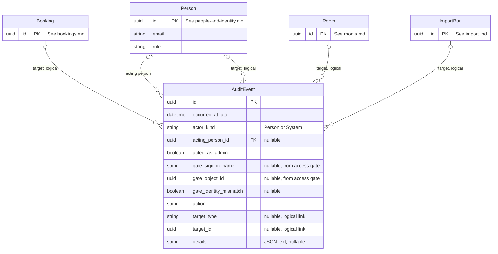

# Audit — Data Model

**Last updated:** 2026-09-29
**Related ADRs:** ADR-0005, ADR-0009, ADR-0015, ADR-0021, ADR-0022 (Proposed)
**External systems:** Microsoft Entra ID (source of the gate identity values only; see people-and-identity.md)
**Requirements:** NFR-019, NFR-020; security assessment SEC-05, SEC-09

## Entities

### AuditEvent

- **Ownership:** Internal
- **Description:** An append-only record of one state change or admin action, written in the same transaction as the change, capturing who the application believed acted, which authenticated account actually passed the access gate, and whether an admin acted.
- **Attributes:**

| Attribute | Type | Required | Description | Notes |
|-----------|------|----------|-------------|-------|
| id | UUID | Yes | Unique identifier | Primary key |
| occurred_at_utc | DateTime (UTC) | Yes | When the action happened | From the injected clock (ADR-0019) |
| actor_kind | Enum | Yes | `Person` or `System` | `System` for the status sweeper (no-show, done) |
| acting_person_id | UUID | No | The person selected in the picker when the action happened | Foreign key to Person. Empty when `actor_kind` is `System`. This is the identity the application acted as (ADR-0005), not proof of who sat at the keyboard |
| acted_as_admin | Boolean | Yes | True when the acting person held the Admin role at the time | Answers "did an admin act" (NFR-020) without joining to the current role |
| gate_sign_in_name | String (max 254) | No | Sign-in name of the account that passed the access gate | From the platform gate (ADR-0021); empty locally, in tests and for `System` events. Personal data. Read-only audit metadata, never used for authorisation. Header name and format to be verified at build time |
| gate_object_id | UUID | No | Immutable Entra object identifier of the gate account | Same source and rules as `gate_sign_in_name` |
| gate_identity_mismatch | Boolean | No | True when a gate identity is present and does not correspond to the acting person's email | Empty when no gate identity is present. Informational for admin review; never blocks an action. Comparison is by case-insensitive email; a mismatch can be legitimate (for example a lent or shared account) and is not proof of misuse |
| action | Enum | Yes | What happened | See action list below |
| target_type | Enum | No | `Booking`, `Room`, `Person`, `ImportRun` | Logical reference, no foreign key, so events survive any future data change |
| target_id | UUID | No | Identifier of the target | Empty for actions without a target (for example a picker switch) |
| details | String (JSON text) | No | Compact before/after facts, for example old and new start, room and attendees on an edit, the cancellation origin, or import counts | Must not hold request bodies or full email addresses of other people (SEC-09). Person references use ids |

- **Action list:** `PickerSwitch`, `BookingCreated`, `BookingEdited`, `BookingCancelled`, `BookingCheckedIn`, `BookingMarkedNoShow`, `BookingMarkedDone`, `RoomCreated`, `RoomUpdated`, `RoomDeactivated`, `RoomReactivated`, `PersonCreated`, `PersonUpdated`, `PersonDeactivated`, `PersonReactivated`, `ImportRunCompleted`, `ImportFileRefused`. Cancellation events carry the `cancellation_origin` in `details`, so late-cancellation and admin-cancellation records can be traced (AO-03, ADR-0015).
- **Rules and constraints:**
  - Append only: the application never updates or deletes audit events; retained for the pilot (NFR-021).
  - Written in the same transaction as the change it describes; sweeper events are `System`.
  - Suggested indexes: `(target_type, target_id, occurred_at_utc)` and `(occurred_at_utc)`.
  - Volume: order of tens of thousands of rows over the pilot.
- **Relationships:**

| Related Entity | Relationship | Cardinality | Description |
|---------------|-------------|-------------|-------------|
| Person (people-and-identity.md) | acting person | N:0..1 | The selected identity |
| Booking, Room, Person, ImportRun | target (logical) | N:0..1 | Polymorphic reference by `target_type` and `target_id`, not a database foreign key |

**Privacy note impact.** `gate_sign_in_name` and `gate_object_id` are additional personal data held in the audit trail. The privacy note (ADR-0015, decision 2) should say that the sign-in name is recorded for audit.

## ERD

## Cross-Domain References

- **Person** (people-and-identity.md): `acting_person_id`, and as a logical target.
- **Booking** (bookings.md), **Room** (rooms.md), **ImportRun** (import.md): logical targets via `target_type` and `target_id`.
