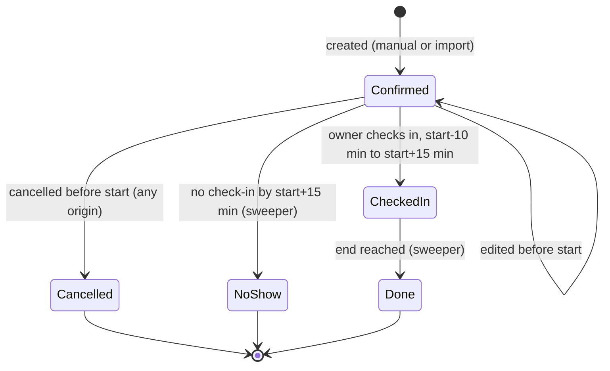
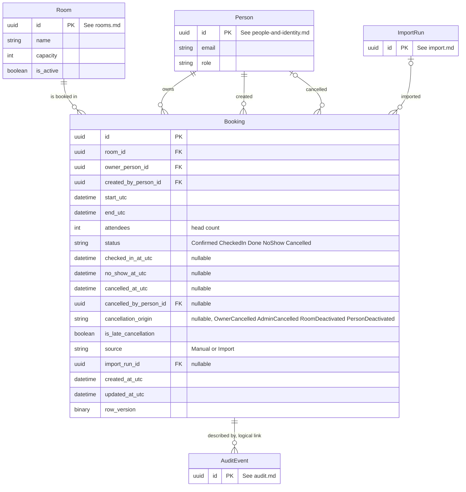

# Bookings — Data Model

**Last updated:** 2026-09-29
**Related ADRs:** ADR-0007, ADR-0008, ADR-0009, ADR-0010, ADR-0013 (Proposed), ADR-0014, ADR-0015, ADR-0018 (Proposed), ADR-0019 (Proposed), ADR-0020 (Proposed)
**External systems:** None
**Modules:** M-01 Room Booking and Availability, M-02 Booking Lifecycle, M-05 Admin Booking Oversight (reads), M-06 Booking Import (writes through the same path)

## Entities

### Booking

- **Ownership:** Internal
- **Description:** One reservation of one room for one time span by one person, with its lifecycle status and the facts needed for admin review of late cancellations and no-shows.
- **Attributes:**

| Attribute | Type | Required | Description | Notes |
|-----------|------|----------|-------------|-------|
| id | UUID | Yes | Unique identifier | Primary key |
| room_id | UUID | Yes | The room booked | Foreign key to Room. A move to another room changes this value |
| owner_person_id | UUID | Yes | The person the booking is for; the only person who can check in and whose 3-booking limit it counts toward | Foreign key to Person |
| created_by_person_id | UUID | Yes | The person who created it: the owner, or an admin booking on behalf of the owner | Foreign key to Person. Equals the owner for self-service and import rows created by an admin acting for themselves; for import rows it is the admin who ran the import |
| start_utc | DateTime (UTC) | Yes | Start instant | Stored in UTC (ADR-0019). Wall-clock rules are evaluated after conversion to the office zone |
| end_utc | DateTime (UTC) | Yes | End instant | Greater than `start_utc` |
| attendees | Integer | Yes | Head count, not a list of people | At least 1 and at most the room's capacity at the time of booking or edit (BR-07) |
| status | Enum | Yes | `Confirmed`, `CheckedIn`, `Done`, `NoShow`, `Cancelled` | See Status lifecycle. Stored state may lag the clock by up to one sweeper interval; rules use effective status (ADR-0018) |
| checked_in_at_utc | DateTime (UTC) | No | When the owner checked in | Set when status becomes `CheckedIn`; kept when it becomes `Done` |
| no_show_at_utc | DateTime (UTC) | No | The no-show moment, start plus 15 minutes | Set when status becomes `NoShow`. A no-show occupies the room only until this moment; the remainder to `end_utc` is bookable |
| cancelled_at_utc | DateTime (UTC) | No | When the booking was cancelled | Set when status becomes `Cancelled` |
| cancelled_by_person_id | UUID | No | The person who performed the cancellation | Foreign key to Person. For deactivation cancellations, the admin who deactivated the room or person |
| cancellation_origin | Enum | No | `OwnerCancelled`, `AdminCancelled`, `RoomDeactivated`, `PersonDeactivated` | Required when status is `Cancelled`. The cancelled-by actor type is derived: `OwnerCancelled` means the owner acted; the other three mean an admin acted (see below) |
| is_late_cancellation | Boolean | Yes | True only when the owner cancelled less than 2 hours before start | Default false. Set once at cancellation and never changed (AO-03). Never true for the three admin origins (ADR-0015, decision 3); never set by an edit (LC-03) |
| source | Enum | Yes | `Manual` or `Import` | Import rows are written through the same booking write service |
| import_run_id | UUID | No | The import run that created it | Foreign key to ImportRun. Required when source is `Import` |
| created_at_utc | DateTime (UTC) | Yes | Creation moment | |
| updated_at_utc | DateTime (UTC) | Yes | Last change moment | |
| row_version | Binary | Yes | Optimistic concurrency token | Guards edits against simultaneous changes; the per-room lock (ADR-0020) guards overlap. POC (SQLite, ADR-0025): application-managed token, since SQLite has no `rowversion`; Azure SQL: `rowversion` |

- **Status lifecycle:**

  There is no separate "Cancelled by admin" status. It is a display label for a `Cancelled` booking whose `cancellation_origin` is not `OwnerCancelled`; the product definition's status list and admin filter map onto this (M-02, M-05).

- **Cancellation origin and actor type:**

| cancellation_origin | Cancelled-by actor type (derived) | is_late_cancellation | Meaning |
|---------------------|-----------------------------------|----------------------|---------|
| OwnerCancelled | Owner | True if cancelled less than 2 hours before start, else false | The owner cancelled (also when the owner is an admin cancelling their own booking) |
| AdminCancelled | Admin | Always false | An admin cancelled someone else's booking directly |
| RoomDeactivated | Admin | Always false | The room was deactivated; future Confirmed bookings were cancelled automatically |
| PersonDeactivated | Admin | Always false | The owner was deactivated; future Confirmed bookings were cancelled automatically |

- **Rules and constraints** (database constraints where the rule is data-only; the rest is enforced by the booking rules and write service):
  - `end_utc` greater than `start_utc`; duration 30 minutes to 4 hours (BR-01, BR-02); `attendees` at least 1.
  - Grid, office hours, weekday, no-past, capacity and the 3-upcoming limit are evaluated in office local time by the rules component, not by the database, because the zone is configuration (ADR-0019).
  - Status-dependent fields: `checked_in_at_utc` required for `CheckedIn` and `Done`; `no_show_at_utc` required for `NoShow`; `cancelled_at_utc`, `cancelled_by_person_id` and `cancellation_origin` required for `Cancelled` and empty otherwise; `is_late_cancellation` true only with origin `OwnerCancelled`.
  - No overlap: no two bookings in the same room may occupy overlapping time (NFR-005). A booking occupies `[start_utc, end_utc)` while `Confirmed`, `CheckedIn` or `Done`; `[start_utc, no_show_at_utc)` when `NoShow`; nothing when `Cancelled`. Back-to-back is allowed. Enforced by the per-room lock and transactional re-check in the single booking write service (ADR-0020, Proposed).
  - "Upcoming" for the 3-booking limit means `Confirmed` bookings whose start has not passed (BR-08). Edits do not add to the count (LC-04).
  - Only `Confirmed` bookings that have not started can be edited or cancelled (LC-01, LC-05, LC-13).
  - Imported duplicates are recognised by same room, owner, start and end among non-cancelled bookings (IM-09); this is an application check, not a unique index.
  - No physical deletion (NFR-021).
  - Suggested indexes: `(room_id, start_utc)` for availability and overlap; `(owner_person_id, status, start_utc)` for my bookings and the limit; `(status, start_utc)` for the sweeper; `(is_late_cancellation, cancelled_at_utc)` and `(status, no_show_at_utc)` for review reports if needed.
- **Relationships:**

| Related Entity | Relationship | Cardinality | Description |
|---------------|-------------|-------------|-------------|
| Room (rooms.md) | belongs to | N:1 | Exactly one room |
| Person (people-and-identity.md) | owned by | N:1 | Exactly one owner |
| Person | created by | N:1 | Exactly one creator |
| Person | cancelled by | N:0..1 | Only when cancelled |
| ImportRun (import.md) | imported by | N:0..1 | Only when source is `Import` |
| AuditEvent (audit.md) | described by | 1:N | Audit events reference a booking through `target_type` and `target_id` (no foreign key) |

**Remainder rebooking (no-show).** The freed remainder is not a separate entity. It is simply unoccupied time: another person creates a new ordinary Booking whose start is on the 15-minute grid at or after `no_show_at_utc` (ADR-0008; the 30-minute minimum is pending ADR-0013). No link back to the no-show booking is stored.

**Effective status (not stored).** For rule evaluation, a `Confirmed` booking whose start plus 15 minutes has passed is treated as `NoShow`, and a `CheckedIn` booking whose end has passed is treated as `Done`, even if the sweeper has not yet persisted the change (ADR-0018).

**Availability read model (not an entity).** Availability returns free or busy per room and time only; it never selects owner, creator or any personal field (NFR-012).

## ERD

## Cross-Domain References

- **Room** (rooms.md): `room_id`.
- **Person** (people-and-identity.md): `owner_person_id`, `created_by_person_id`, `cancelled_by_person_id`.
- **ImportRun** (import.md): `import_run_id`.
- **AuditEvent** (audit.md): refers to bookings by `target_type` and `target_id`.
