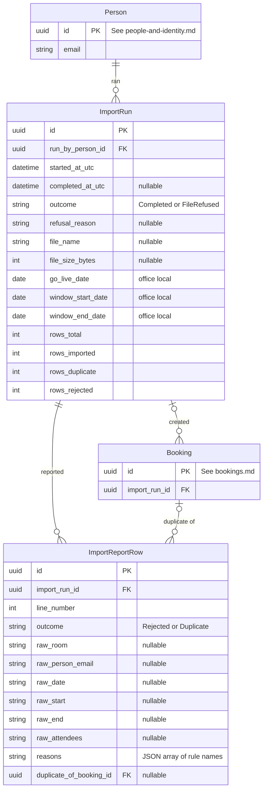

# Import — Data Model

**Last updated:** 2026-09-29
**Related ADRs:** ADR-0010, ADR-0011 (Proposed), ADR-0012 (Proposed), ADR-0014, ADR-0015
**External systems:** Spreadsheet CSV export (file only; the raw file is not stored)
**Module:** M-06 Booking Import

## Entities

### ImportRun

- **Ownership:** Internal
- **Description:** One execution of the one-off import: who ran it, for which window, and the resulting counts; also the parent of the rejected-row report.
- **Attributes:**

| Attribute | Type | Required | Description | Notes |
|-----------|------|----------|-------------|-------|
| id | UUID | Yes | Unique identifier | Primary key |
| run_by_person_id | UUID | Yes | The admin (selected identity) who ran the import | Foreign key to Person. The gate account is recorded on the related AuditEvent |
| started_at_utc | DateTime (UTC) | Yes | Start moment | |
| completed_at_utc | DateTime (UTC) | No | End moment | Empty while running or if the run failed unexpectedly |
| outcome | Enum | Yes | `Completed` or `FileRefused` | `FileRefused` when the whole file is refused (wrong encoding, missing header, over the size or row cap); no bookings were written |
| refusal_reason | String (max 500) | No | Message shown when the file was refused | Required when outcome is `FileRefused` |
| file_name | String (max 260) | No | Name of the uploaded file as supplied | Display only. Treated as untrusted text |
| file_size_bytes | Integer | No | Size of the uploaded file | The raw file itself is discarded after processing (integration assessment, gap 9) |
| go_live_date | Date (office local) | Yes | Go-live date entered by the admin | A local calendar date, not an instant |
| window_start_date | Date (office local) | Yes | First working day of the window | The go-live date if it is a weekday, else the following Monday (ADR-0015, decision 5) |
| window_end_date | Date (office local) | Yes | Last working day of the window | Fifth working day from the start, Monday to Friday, no holiday calendar (ADR-0014, rule 4) |
| rows_total | Integer | Yes | Data rows read from the file | Zero when refused |
| rows_imported | Integer | Yes | Rows written as Confirmed bookings | |
| rows_duplicate | Integer | Yes | Rows identical to an existing booking | Reported, not created twice (IM-09) |
| rows_rejected | Integer | Yes | Rows rejected with reasons | Equals the count of report rows with outcome `Rejected` |

- **Rules and constraints:**
  - `rows_total` equals imported plus duplicate plus rejected.
  - The import page is admin-only and can be disabled by configuration after the pilot start (IM-10, IM-11). The setting is application configuration, not stored data.
  - Several runs are expected (a corrected file is re-imported). No deletion; retained for the pilot.
  - Volume: a handful of runs.
- **Relationships:**

| Related Entity | Relationship | Cardinality | Description |
|---------------|-------------|-------------|-------------|
| Person (people-and-identity.md) | run by | N:1 | The admin who ran it |
| Booking (bookings.md) | created | 1:N | Bookings with `source` `Import` and this `import_run_id` |
| ImportReportRow | reported | 1:N | Rejected and duplicate rows for this run |

### ImportReportRow

- **Ownership:** Internal
- **Description:** One line of the import report for a row that was not imported: either rejected with the rules it broke, or reported as a duplicate. The downloadable "rejected rows" CSV is generated from these rows.
- **Attributes:**

| Attribute | Type | Required | Description | Notes |
|-----------|------|----------|-------------|-------|
| id | UUID | Yes | Unique identifier | Primary key |
| import_run_id | UUID | Yes | The run this line belongs to | Foreign key to ImportRun |
| line_number | Integer | Yes | Line number in the uploaded file | Header is line 1 |
| outcome | Enum | Yes | `Rejected` or `Duplicate` | Imported rows have no report row; they are identifiable through Booking `import_run_id` |
| raw_room | String (max 200) | No | `room` value exactly as supplied | Untrusted text. Escaped against formula injection wherever echoed or exported (SEC-06) |
| raw_person_email | String (max 320) | No | `person_email` value as supplied | Personal data; may not match any Person |
| raw_date | String (max 50) | No | `date` value as supplied | Kept as text so malformed values can be reported unchanged |
| raw_start | String (max 50) | No | `start` value as supplied | As above |
| raw_end | String (max 50) | No | `end` value as supplied | As above |
| raw_attendees | String (max 50) | No | `attendees` value as supplied | As above |
| reasons | Array of strings (stored as JSON text) | Yes for `Rejected` | Every broken rule, by name, with a readable message | Rule codes: `MissingOrBadFormat`, `RoomUnknown`, `RoomInactive`, `PersonUnknown`, `PersonInactive`, `OutsideWindow`, `NotWorkingDay`, `OffGrid`, `OutsideOfficeHours`, `DurationTooShort`, `DurationTooLong`, `CapacityExceeded`, `InvalidAttendees`, `Overlap`, `LimitExceeded`, `InPast`. Names match the refusal messages shown for manual booking (NFR-017) |
| duplicate_of_booking_id | UUID | No | The existing booking an identical row matched | Foreign key to Booking. Required when outcome is `Duplicate` |

- **Rules and constraints:**
  - Values are stored as received: nothing is corrected, trimmed to look valid or adjusted (IM-06).
  - Retained with the run until the import is settled, then purged (accepted by the project lead, 2026-09-29, ADR-0024), because these rows can hold email addresses that match no person. The ImportRun counts and the audit event remain. This is the one exception to the "keep everything during the pilot" reading of NFR-021.
  - Volume: tens to a few hundred rows per run.
- **Relationships:**

| Related Entity | Relationship | Cardinality | Description |
|---------------|-------------|-------------|-------------|
| ImportRun | belongs to | N:1 | Exactly one run |
| Booking (bookings.md) | duplicate of | N:0..1 | Only for `Duplicate` |

## ERD

## Cross-Domain References

- **Person** (people-and-identity.md): `run_by_person_id`.
- **Booking** (bookings.md): `Booking.import_run_id`; `duplicate_of_booking_id`.
- **AuditEvent** (audit.md): `ImportRunCompleted` and `ImportFileRefused` events reference the run logically.
