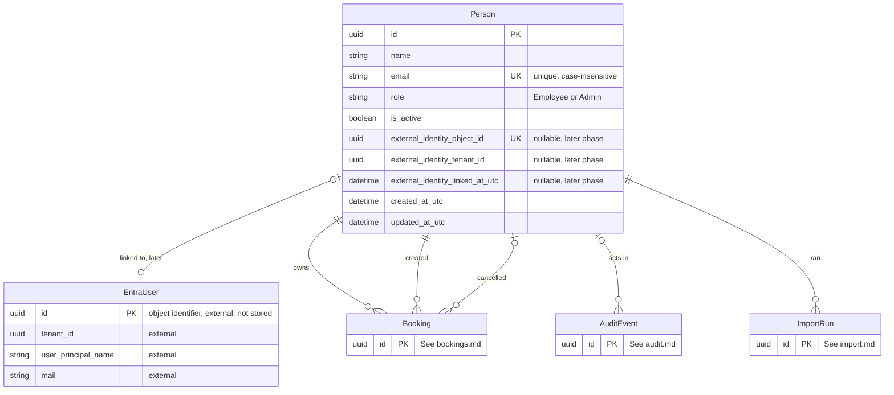

# People and Identity — Data Model

**Last updated:** 2026-09-29
**Related ADRs:** ADR-0004, ADR-0005, ADR-0006, ADR-0014, ADR-0021, ADR-0022 (Proposed)
**External systems:** Microsoft Entra ID (referenced only; nothing is copied or synchronised)
**Module:** M-04 People and Identity

## Entities

### Person

- **Ownership:** Internal
- **Description:** A user of the tool, managed by admins, who holds exactly one role and is keyed by a unique, case-insensitive email address.
- **Attributes:**

| Attribute | Type | Required | Description | Notes |
|-----------|------|----------|-------------|-------|
| id | UUID | Yes | Unique identifier | Primary key. The picker cookie stores only this id (ADR-0022) |
| name | String (1-200) | Yes | Display name shown in the picker, header and admin lists | Personal data |
| email | String (max 254) | Yes | Identity key; matches the import column `person_email` and the future Microsoft account | Unique, case-insensitive (database collation, NFR-023). Personal data. Editing it is an admin-only controlled edit; past bookings follow the person because they reference `id` |
| role | Enum | Yes | `Employee` or `Admin` | Exactly one role per person (PI-09). Role is always read from the database on each request, never from the cookie |
| is_active | Boolean | Yes | Inactive people are not listed in the picker and cannot be booked for | Deactivation cancels future Confirmed bookings (see Booking); no deletion, history is kept |
| external_identity_object_id | UUID | No | Immutable Microsoft Entra object identifier, set at first in-app sign-in | Empty throughout the pilot. Unique when present. Added by ADR-0022 (Proposed) |
| external_identity_tenant_id | UUID | No | Entra tenant identifier of the linked account | Empty in the pilot. Set together with the object identifier |
| external_identity_linked_at_utc | DateTime (UTC) | No | When the account was linked | Empty in the pilot |
| created_at_utc | DateTime (UTC) | Yes | Creation moment | |
| updated_at_utc | DateTime (UTC) | Yes | Last change moment | |

- **Rules and constraints:**
  - Email unique ignoring case (unique index on a case-insensitive collation).
  - At most about 50 rows (PI-03, NFR-001); enforced as an admin-facing message, not a database limit.
  - The last active admin cannot be deactivated or demoted (PI-07, assumption); application rule.
  - `external_identity_object_id` and `external_identity_tenant_id` are both empty or both set; unique index on the object identifier where not empty.
  - No physical deletion of people.
- **Relationships:**

| Related Entity | Relationship | Cardinality | Description |
|---------------|-------------|-------------|-------------|
| Booking (bookings.md) | owns | 1:N | Bookings where the person is the owner (`owner_person_id`) |
| Booking (bookings.md) | created | 1:N | Bookings the person created, which differ from owned ones when an admin books on behalf of someone (`created_by_person_id`) |
| Booking (bookings.md) | cancelled | 1:N | Bookings the person cancelled, including deactivation cancellations performed by an admin (`cancelled_by_person_id`) |
| AuditEvent (audit.md) | acts in | 1:N | Audit events where the person is the selected acting person |
| ImportRun (import.md) | ran | 1:N | Import runs started by an admin |
| EntraUser [External] | linked to | 1:0..1 | Future link by object identifier; no foreign key, the identifier is stored on the person |

### EntraUser [External]

- **Ownership:** External (Microsoft Entra ID)
- **Description:** A user object in the company's Entra tenant. It is not stored in this system; it appears here only because ADR-0022 links a person to it by object identifier at the later sign-in phase, and because the pilot gate (ADR-0021) exposes a subset of its claims to the application for the audit trail.
- **Attributes (subset relevant to this system, from general Microsoft platform knowledge; to be verified against current Microsoft Entra documentation at build time):**

| Attribute | Type | Required | Description | Notes |
|-----------|------|----------|-------------|-------|
| id (object identifier) | UUID | Yes | Immutable identifier of the user in the tenant | Stored on Person as `external_identity_object_id` at link time; recorded on AuditEvent as `gate_object_id` in the pilot |
| tenant_id | UUID | Yes | Identifier of the directory | Stored on Person as `external_identity_tenant_id` |
| user_principal_name | String | Yes | Sign-in name of the account | Recorded on AuditEvent as `gate_sign_in_name` in the pilot; may differ from `mail` |
| mail | String | No | Email address | May be absent or an alias; used only for the one-time first-link match against `Person.email` (ADR-0022) |
| display_name | String | No | Display name | Not stored |

- **Relationships:**

| Related Entity | Relationship | Cardinality | Description |
|---------------|-------------|-------------|-------------|
| Person | is matched to | 0..1:1 | One Entra user is linked to at most one Person |

Custom fields on the external entity: none. Context7 was not used for this model; the subset above is general platform knowledge and must be confirmed in the sign-in phase.

## Gate identity (value, not an entity)

In the pilot, the Easy Auth gate (ADR-0021) passes the authenticated sign-in name and object identifier to the application with each request. They are not stored on Person and are not used for authorisation. They are copied onto each AuditEvent (`gate_sign_in_name`, `gate_object_id`) so that a picked identity can be compared with the account that actually signed in. See audit.md.

## ERD

## Cross-Domain References

- **Booking** (bookings.md) references Person three times: owner, creator and canceller.
- **AuditEvent** (audit.md) references Person as the selected acting person (empty for system actions such as the status sweeper).
- **ImportRun** (import.md) references Person as the admin who ran the import.
