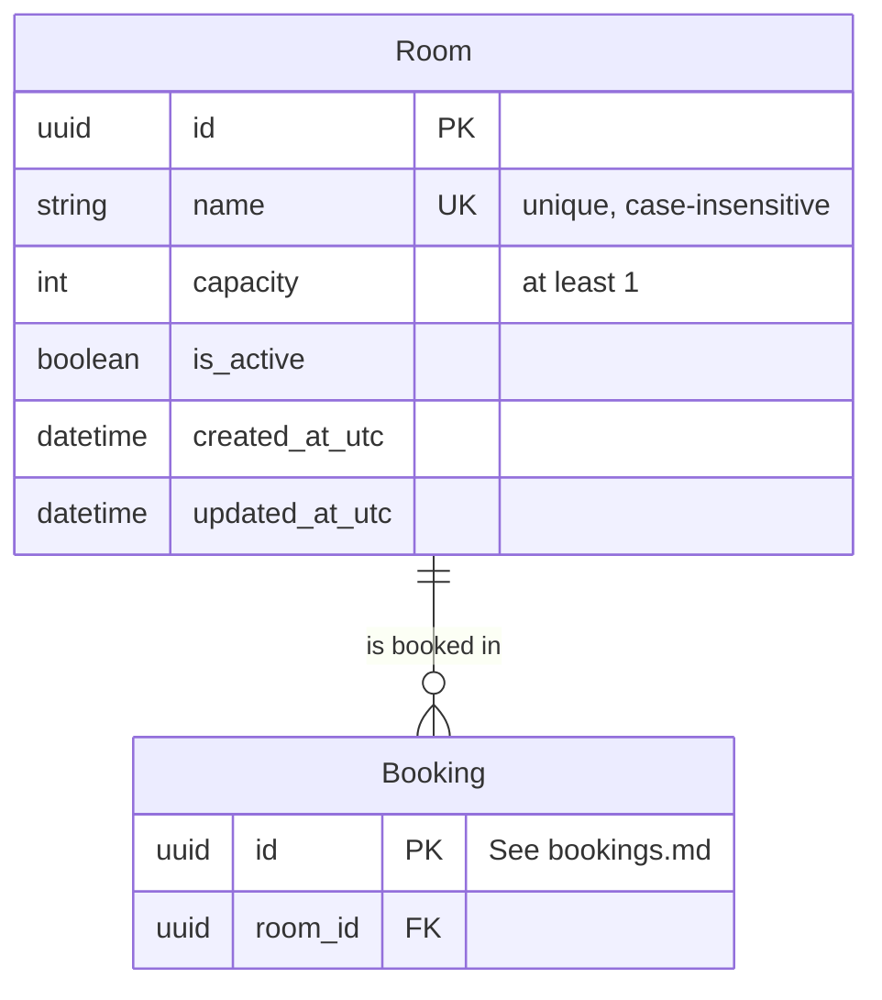

# Rooms — Data Model

**Last updated:** 2026-09-29
**Related ADRs:** ADR-0005, ADR-0014, ADR-0020 (Proposed)
**External systems:** None
**Module:** M-03 Room Management

## Entities

### Room

- **Ownership:** Internal
- **Description:** A bookable meeting room with a name, a capacity and an active flag; rooms are deactivated, never deleted.
- **Attributes:**

| Attribute | Type | Required | Description | Notes |
|-----------|------|----------|-------------|-------|
| id | UUID | Yes | Unique identifier | Primary key |
| name | String (1-100) | Yes | Room name shown to users and matched exactly by the import column `room` | Unique, case-insensitive (RM-02) |
| capacity | Integer | Yes | Maximum number of attendees | Whole number, at least 1 (RM-01). Lowering it leaves existing bookings unchanged (RM-05) |
| is_active | Boolean | Yes | Inactive rooms are not offered for booking or import | Deactivation cancels future Confirmed bookings with origin `RoomDeactivated`; in-progress bookings are left as is (RM-03, RM-04) |
| created_at_utc | DateTime (UTC) | Yes | Creation moment | |
| updated_at_utc | DateTime (UTC) | Yes | Last change moment | |

- **Rules and constraints:**
  - Name unique ignoring case; capacity greater than or equal to 1.
  - No physical deletion, so booking history keeps its room.
  - The Room row is the lock target for booking writes: every create, move or import row locks the room row (or both rows when an edit changes room, in a fixed order) inside a transaction before the overlap check (ADR-0020, Proposed). This needs no extra column. If the alternative slot-table safeguard of ADR-0020 is ever adopted, a BookingSlot entity would be added.
- **Relationships:**

| Related Entity | Relationship | Cardinality | Description |
|---------------|-------------|-------------|-------------|
| Booking (bookings.md) | is booked in | 1:N | A room has many bookings over time; a booking has exactly one room |

**Seed data** *(Source: room-booking-spec.md, Rooms we have today; room-management.md, Starting data)*

| name | capacity | is_active |
|------|----------|-----------|
| Focus | 2 | true |
| Team | 6 | true |
| Board | 12 | true |
| Old Room | 4 | false |

## ERD

## Cross-Domain References

- **Booking** (bookings.md) holds `room_id`.
