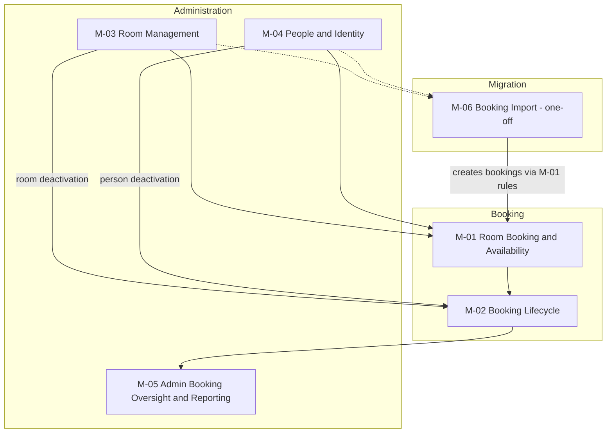

# Module Registry

Index of all product modules. One file per module in this folder.

## Naming convention

`<module-slug>.md` — kebab-case, derived from the module name. Example: `subscription-management.md`

## Module index

| ID | Module | Phase | Status | File |
|----|--------|-------|--------|------|
| M-01 | Room Booking and Availability | 1 (pilot) | defined | [room-booking-and-availability.md](room-booking-and-availability.md) |
| M-02 | Booking Lifecycle | 1 (pilot) | defined | [booking-lifecycle.md](booking-lifecycle.md) |
| M-03 | Room Management | 1 (pilot) | defined | [room-management.md](room-management.md) |
| M-04 | People and Identity | 1 (pilot) | defined | [people-and-identity.md](people-and-identity.md) |
| M-05 | Admin Booking Oversight and Reporting | 1 (pilot) | defined | [admin-booking-oversight.md](admin-booking-oversight.md) |
| M-06 | Booking Import | 1 (pilot, one-off) | defined | [booking-import.md](booking-import.md) |

**Last updated:** 2026-09-29. Pick-a-user and Microsoft-ready identity are part of M-04 (People and Identity); the booking status lifecycle diagram is in M-02.

## Module map



Pending client confirmation: ADR-0011, ADR-0012 (M-06) and ADR-0013 (M-01, M-02).

## Module file template

See the template below. Copy it when creating a new module file.

```markdown
---
id: M-NN
name: <Module Name>
phase: 1
status: proposed
epic: E-NN
adr-refs: []
---

# Module: <Module Name>

## Purpose
One paragraph. What this module does and why it exists.

## Key Capabilities
- ...

## Interfaces
- **Depends on:** [other modules or external systems]
- **Consumed by:** [other modules]

## Non-Functional Requirements
| Requirement | Target | Source ADR |
|-------------|--------|------------|
| ...         | ...    | ...        |

## Open Decisions
- [ ] [Question — link to ADR if created]

## Notes
[Constraints, client preferences, known complexity.]
```
