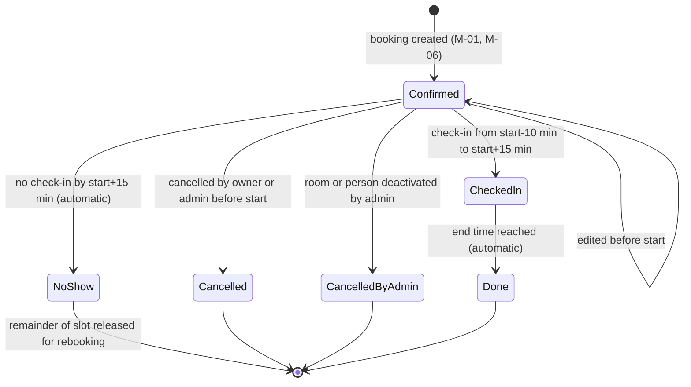

# Module: Booking Lifecycle

**Last updated:** 2026-09-29

## Purpose

This module governs what happens to a booking after it is created: editing, cancelling, checking in, automatic no-show handling and automatic completion. It exists to stop people hogging rooms "just in case" by making unused bookings visible and releasing their time automatically. *(Source: room-booking-spec.md, Background; Cancelling; Checking in)*

## Booking Status Lifecycle

A cancellation made less than 2 hours before the start additionally carries a **late cancellation** flag; it is a marker on the Cancelled status, not a separate status. *(Source: room-booking-spec.md, Cancelling)*

Status definitions:

| Status | Meaning |
|--------|---------|
| Confirmed | Booked, not yet started. This is what counts as "upcoming" for the 3-booking limit |
| Checked in | Owner has checked in; the meeting is going ahead |
| Cancelled | Cancelled by the owner or by an admin acting directly on the booking |
| Cancelled by admin | Cancelled automatically because an admin deactivated the room or the person; visible to the booker as an admin action, not their own |
| No-show | Nobody checked in within 15 minutes of the start; room freed |
| Done | A checked-in booking whose end time has passed |

## Users and Roles

- **Employee:** edits, cancels and checks in to their own bookings.
- **Admin:** edits and cancels anyone's booking. Check-in for another person is not stated in the sources (see Open Items).
- **System:** performs no-show marking, room release and done marking automatically. *(Source: client-qa-2026-09-29.md, Working assumptions)*

## Key Capabilities

1. **Edit a booking.** The owner (or an admin) can change room, date, start, end and attendees of a booking that has not started. The edit is validated against all booking rules from M-01 as if it were a new request, excluding the booking's own current slot from the overlap check. *(Source: client-qa-2026-09-29.md, Answers 3 and 10; ADR-0007; ADR-0014)*
2. **Cancel a booking.** Owner or admin cancels a booking that has not started. If it is cancelled less than 2 hours before the start, it is marked as a late cancellation. *(Source: room-booking-spec.md, Cancelling)*
3. **Check in.** The owner checks in from their own laptop or phone browser within the check-in window. No room-side device is provided. *(Source: client-qa-2026-09-29.md, Answer 5; ADR-0003)*
4. **Automatic no-show.** If nobody has checked in 15 minutes after the start, the booking becomes a no-show and the remaining time is released for rebooking. *(Source: room-booking-spec.md, Checking in)*
5. **Automatic done.** When the end time of a checked-in booking passes, it becomes Done. *(Source: room-booking-spec.md, Checking in)*
6. **Cancelled-by-admin visibility.** A booker can see that a booking was cancelled by an admin rather than by themselves. *(Source: room-booking-spec.md, For admins)*

## Business Rules

| # | Rule | Value | Source |
|---|------|-------|--------|
| LC-01 | Editable states | Only Confirmed bookings that have not started can be edited | ADR-0014, rule 1 |
| LC-02 | Edits re-validate | Every edit re-runs all M-01 rules (grid, duration, hours, capacity, overlap, past) | ADR-0007 |
| LC-03 | Edits are never late | Editing is never flagged as a late cancellation, even seconds before the start | client-qa-2026-09-29.md, Answer 10; ADR-0007 |
| LC-04 | Edits and the limit | An edit is not a new booking and does not increase a person's count toward the 3-booking limit | ADR-0014, rule 2 |
| LC-05 | Cancellable states | Only Confirmed bookings that have not started can be cancelled; once started or finished, they cannot | room-booking-spec.md, Cancelling |
| LC-06 | Late cancellation | Cancelled with less than 2 hours before start: flagged late. Exactly 2 hours or more: not flagged | room-booking-spec.md, Cancelling |
| LC-07 | Check-in window | From 10 minutes before the start until 15 minutes after the start | room-booking-spec.md, Checking in |
| LC-08 | No-show | No check-in within 15 minutes of the start marks the booking No-show and releases the room | room-booking-spec.md, Checking in |
| LC-09 | Remainder release | The time from the no-show moment to the original end becomes bookable, starts on the 15-minute grid; 30-minute minimum pending ADR-0013 | ADR-0008; ADR-0013 |
| LC-10 | Done | Checked-in bookings become Done after their end time | room-booking-spec.md, Checking in |
| LC-11 | No automatic penalty | Late cancellations and no-shows are only recorded for admin review; there are no automatic consequences such as blocking or limit reduction | client-qa-2026-09-29.md, Answer 6; ADR-0009 |
| LC-12 | Cancelled by admin | Bookings cancelled because a room or person was deactivated are marked "cancelled by admin" and are not counted as the booker's late cancellations | room-booking-spec.md, For admins; ADR-0014, rule 3 (not-counted-as-late is an assumption, see Open Items) |
| LC-13 | Started means started | A booking is "started" from its start time onward, whether or not it was checked in | ADR-0014, rule 1 |

## Interfaces

- **Depends on:** Room Booking and Availability (M-01) for the rule set; People and Identity (M-04) for roles.
- **Consumed by:** Admin Booking Oversight (M-05) reads status and flags; Room Management (M-03) and People Management (M-04) trigger the "cancelled by admin" transition.

## Out of Scope

Email or calendar notifications of cancellations, reminders or no-shows; automatic penalties or blocking; recurring booking series; delegated check-in by a named attendee.

## Related ADRs

ADR-0003, ADR-0007, ADR-0008, ADR-0009, ADR-0013 (Proposed), ADR-0014.

## Open Items

- [ ] Can an admin check in on behalf of a booking's owner? Sources say "the booker checks in" (working assumption). Assumed: the owner only, until confirmed. **Resolved by ADR-0015:** only the booking owner can check in; admins cannot check in on someone's behalf.
- [ ] When an admin cancels someone else's booking directly (not through deactivation) less than 2 hours before start, is it a late cancellation attributed to the owner? Proposed default: not attributed to the owner, recorded as cancelled by an admin. Needs confirmation. **Resolved by ADR-0015:** not flagged as a late cancellation, because it was not the person's choice.
- [ ] "Cancelled by admin" from deactivation is assumed never to be flagged late (LC-12). **Resolved by ADR-0015:** deactivation cancellations are never late-flagged.
- [ ] A deactivated room or person with a booking already in progress: assumed left untouched (it has started; ADR-0014 speaks only of future bookings).
- [ ] Late-cancellation boundary is "less than 2 hours" (strictly); confirm whether exactly 2 hours is on the safe side.
- [ ] Confirm 30-minute minimum for remainder (ADR-0013, Proposed).
